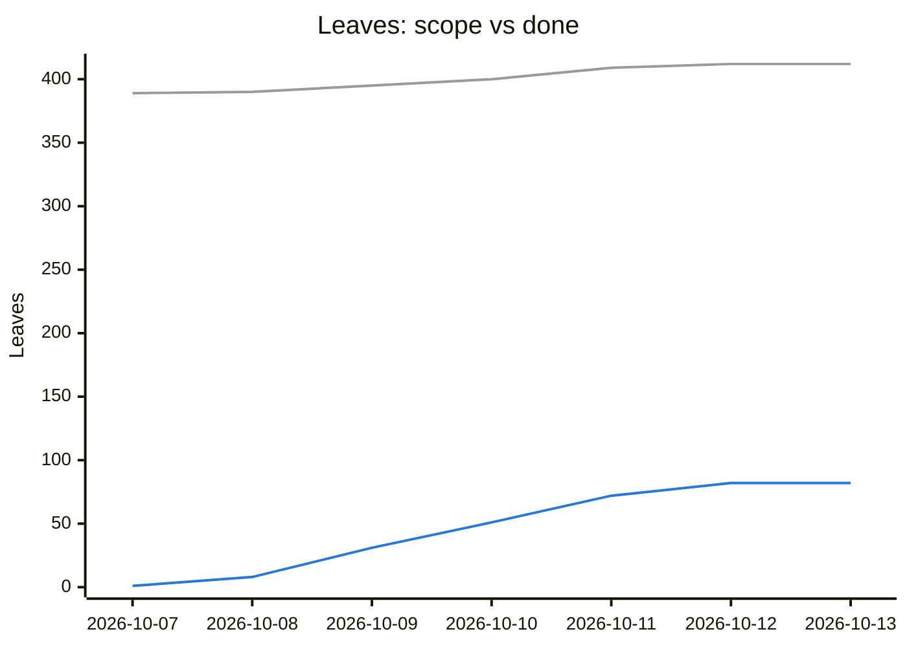

<!-- GENERATED by `cargo xtask progress` from ROADMAP.md. Do not edit by hand. -->
# Persia DB — Progress

**82/412 leaves done (20%)** · 5 in progress · `██████░░░░░░░░░░░░░░░░░░░░░░░░` · last snapshot: 2026-10-13

Status lives in [`ROADMAP.md`](./ROADMAP.md) checkboxes (`[ ]` todo · `[~]` in progress · `[x]` done).
After changing one, run `cargo xtask progress --record`.

## Milestone graph

Arrows point from a dependency to the milestone that needs it (implied edges omitted).
✅ done · 🔨 in progress · ▶️ ready (deps done) · ⏳ blocked

```mermaid
flowchart LR
  M0["✅ done<br/><b>M0</b> Project bootstrap<br/>26/26 · 100%"]:::done
  M1["✅ done<br/><b>M1</b> Format primitives<br/>53/53 · 100%"]:::done
  M2["🔨 in progress<br/><b>M2</b> Storage abstraction & local backends<br/>3/29 · 10%"]:::doing
  M3["▶️ ready<br/><b>M3</b> Schema, documents, collections<br/>0/15 · 0%"]:::ready
  M4["▶️ ready<br/><b>M4</b> Text analysis<br/>0/22 · 0%"]:::ready
  M5["⏳ blocked<br/><b>M5</b> Segment writer & reader<br/>0/36 · 0%"]:::blocked
  M6["⏳ blocked<br/><b>M6</b> Write path, durability, merging<br/>0/29 · 0%"]:::blocked
  M7["⏳ blocked<br/><b>M7</b> Query engine & ranking<br/>0/29 · 0%"]:::blocked
  M8["⏳ blocked<br/><b>M8</b> Zero-results avoidance<br/>0/23 · 0%"]:::blocked
  M9["⏳ blocked<br/><b>M9</b> Blob store<br/>0/20 · 0%"]:::blocked
  M10["⏳ blocked<br/><b>M10</b> Embedded API<br/>0/17 · 0%"]:::blocked
  M11["⏳ blocked<br/><b>M11</b> Server<br/>0/22 · 0%"]:::blocked
  M12["⏳ blocked<br/><b>M12</b> Cloud storage backends<br/>0/29 · 0%"]:::blocked
  M13["⏳ blocked<br/><b>M13</b> Distribution & Kubernetes<br/>0/24 · 0%"]:::blocked
  M14["⏳ blocked<br/><b>M14</b> SDKs<br/>0/17 · 0%"]:::blocked
  M15["⏳ blocked<br/><b>M15</b> Benchmarks, hardening, v1.0<br/>0/21 · 0%"]:::blocked
  M0 --> M1
  M1 --> M2
  M1 --> M3
  M0 --> M4
  M3 --> M5
  M4 --> M5
  M2 --> M6
  M5 --> M6
  M5 --> M7
  M7 --> M8
  M2 --> M9
  M6 --> M10
  M8 --> M10
  M9 --> M10
  M10 --> M11
  M11 --> M12
  M12 --> M13
  M13 --> M14
  M14 --> M15
  classDef done fill:#0ca30c,stroke:#0b0b0b,color:#0b0b0b
  classDef doing fill:#fab219,stroke:#0b0b0b,color:#0b0b0b
  classDef ready fill:#fcfcfb,stroke:#0b0b0b,stroke-width:2px,color:#0b0b0b
  classDef blocked fill:#e8e8e6,stroke:#9a9a96,stroke-dasharray:4 3,color:#52514e
```

## Milestones

| Milestone | State | Progress | Done | Doing | Leaves | Deps |
|---|---|---|--:|--:|--:|---|
| **M0** Project bootstrap | ✅ done | `████████████████████` 100% | 26 | 0 | 26 | — |
| **M1** Format primitives | ✅ done | `████████████████████` 100% | 53 | 0 | 53 | M0 |
| **M2** Storage abstraction & local backends | 🔨 in progress | `██▒▒▒░░░░░░░░░░░░░░░` 10% | 3 | 5 | 29 | M1 |
| **M3** Schema, documents, collections | ▶️ ready | `░░░░░░░░░░░░░░░░░░░░` 0% | 0 | 0 | 15 | M1 |
| **M4** Text analysis | ▶️ ready | `░░░░░░░░░░░░░░░░░░░░` 0% | 0 | 0 | 22 | M0 |
| **M5** Segment writer & reader | ⏳ blocked | `░░░░░░░░░░░░░░░░░░░░` 0% | 0 | 0 | 36 | M1, M3, M4 |
| **M6** Write path, durability, merging | ⏳ blocked | `░░░░░░░░░░░░░░░░░░░░` 0% | 0 | 0 | 29 | M2, M5 |
| **M7** Query engine & ranking | ⏳ blocked | `░░░░░░░░░░░░░░░░░░░░` 0% | 0 | 0 | 29 | M5 |
| **M8** Zero-results avoidance | ⏳ blocked | `░░░░░░░░░░░░░░░░░░░░` 0% | 0 | 0 | 23 | M7 |
| **M9** Blob store | ⏳ blocked | `░░░░░░░░░░░░░░░░░░░░` 0% | 0 | 0 | 20 | M1, M2 |
| **M10** Embedded API | ⏳ blocked | `░░░░░░░░░░░░░░░░░░░░` 0% | 0 | 0 | 17 | M6, M7, M8, M9 |
| **M11** Server | ⏳ blocked | `░░░░░░░░░░░░░░░░░░░░` 0% | 0 | 0 | 22 | M10 |
| **M12** Cloud storage backends | ⏳ blocked | `░░░░░░░░░░░░░░░░░░░░` 0% | 0 | 0 | 29 | M2, M6, M9, M11 |
| **M13** Distribution & Kubernetes | ⏳ blocked | `░░░░░░░░░░░░░░░░░░░░` 0% | 0 | 0 | 24 | M11, M12 |
| **M14** SDKs | ⏳ blocked | `░░░░░░░░░░░░░░░░░░░░` 0% | 0 | 0 | 17 | M11, M13 |
| **M15** Benchmarks, hardening, v1.0 | ⏳ blocked | `░░░░░░░░░░░░░░░░░░░░` 0% | 0 | 0 | 21 | M1, M2, M3, M4, M5, M6, M7, M8, M9, M10, M11, M12, M13, M14 |

## In progress

- `2.2.1` `MemoryStorage` implementing all ops incl. `put_if_absent` atomicity (M2)
- `2.2.2.1` Inject: error on Nth call, latency, torn put (partial bytes), dropped put (M2)
- `2.2.2.2` Seeded RNG schedule so failures are reproducible (M2)
- `2.2.2.3` Inject "applied, response lost" (write lands, call returns `Transient`); [T] a retried `put_if_absent` finding its own write returns `Created` (SPEC §10.1) (M2)
- `2.2.3` [T] conformance test-suite (generic over `Storage`) reused by every backend (M2)

## Ready next (first 15 todo leaves whose milestone deps are done)

- `2.3.1` Atomic `put`: write temp → fsync → rename → fsync dir (M2)
- `2.3.2` `put_if_absent` via `O_EXCL`/`link` semantics (M2)
- `2.3.3` `get_range` using pread; `list` with prefix; `delete` (M2)
- `2.3.4` Path-safety: reject `..`, absolute keys, invalid UTF-8; segments over 255 bytes and (Windows) reserved names and trailing `.`/space as `InvalidInput`; `list` never resolves a prefix as a path (SPEC §10.1); [T] traversal attempts (M2)
- `2.3.5` Run conformance suite (M2)
- `2.3.6` Mapped reads of committed container ranges via `MmapFile` (SPEC §4.7, ADR-0010): opt-in, or automatic only on local disk filesystems; `pread` fallback otherwise; mapping granularity (per frame vs `log_end` window); the only `unsafe` call site outside `persia-format` (M2)
- `2.4.1.1` Exclusive writer lock (`flock`) with clear error when held (M2)
- `2.4.1.2` Read-only open mode (also when rocompat flags unknown) (M2)
- `2.4.2` Append frames with group-fsync API (`append`, `sync`) (M2)
- `2.4.3.1` [T] crash simulation: fail after each step 1/2/3, reopen, assert previous or new commit visible, never partial (M2)
- `2.4.4.1` Choose superblock, scan from `log_end`, truncate torn tail (M2)
- `2.4.4.2` [T] an invalid frame in `wal_start..log_end` is `Corrupt` and never truncated; creating a container never truncates an existing file (SPEC §4.7, §8.6) (M2)
- `2.4.5.1` Dead-space accounting (M2)
- `2.4.5.2` [T] crash during compaction leaves a valid old or new file (M2)
- `2.4.5.3` Windows: test whether an open mapping blocks `rename` over the container; if so, close mappings or defer the swap until readers drain (ADR-0010) (M2)
- … and 43 more

## Burn-up

Gray line: total leaves (scope). Blue line: leaves done.

| Date | Done | In progress | Total | Done % |
|---|--:|--:|--:|--:|
| 2026-10-07 | 1 | 2 | 389 | 0% |
| 2026-10-08 | 8 | 2 | 390 | 2% |
| 2026-10-09 | 31 | 0 | 395 | 8% |
| 2026-10-10 | 51 | 0 | 400 | 13% |
| 2026-10-11 | 72 | 0 | 409 | 18% |
| 2026-10-12 | 82 | 0 | 412 | 20% |
| 2026-10-13 | 82 | 5 | 412 | 20% |
