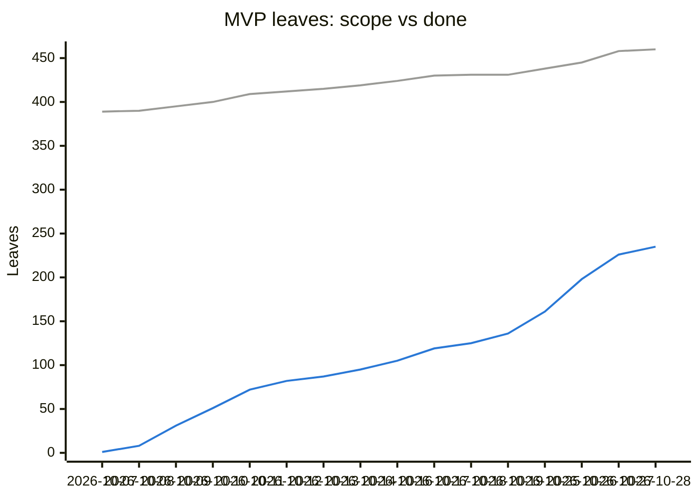

<!-- GENERATED by `cargo xtask progress` from ROADMAP.md. Do not edit by hand. -->
# Persia DB — Progress

**235/460 leaves done (51%)** · 4 in progress · `███████████████░░░░░░░░░░░░░░░` · last snapshot: 2026-10-28

MVP (M0–M15): the counts above. Post-MVP: **0/151 leaves done (0%)** · 0 in progress. Those leaves are not part of the percentage, the graph, the ready-next list, or the burn-up. In-progress ones are listed under Post-MVP.

Status lives in [`ROADMAP.md`](./ROADMAP.md) checkboxes (`[ ]` todo · `[~]` in progress · `[x]` done).
After changing one, run `cargo xtask progress --record`.

## Milestone graph

Arrows point from a dependency to the milestone that needs it (implied edges omitted).
✅ done · 🔨 in progress · ▶️ ready (deps done) · ⏳ blocked

```mermaid
flowchart LR
  M0["✅ done<br/><b>M0</b> Project bootstrap<br/>26/26 · 100%"]:::done
  M1["✅ done<br/><b>M1</b> Format primitives<br/>53/53 · 100%"]:::done
  M2["✅ done<br/><b>M2</b> Storage abstraction & local backends<br/>46/46 · 100%"]:::done
  M3["✅ done<br/><b>M3</b> Schema, documents, collections<br/>15/15 · 100%"]:::done
  M4["✅ done<br/><b>M4</b> Text analysis<br/>29/29 · 100%"]:::done
  M5["✅ done<br/><b>M5</b> Segment writer & reader<br/>48/48 · 100%"]:::done
  M6["🔨 in progress<br/><b>M6</b> Write path, durability, merging<br/>18/38 · 47%"]:::doing
  M7["▶️ ready<br/><b>M7</b> Query engine & ranking<br/>0/29 · 0%"]:::ready
  M8["⏳ blocked<br/><b>M8</b> Zero-results avoidance<br/>0/23 · 0%"]:::blocked
  M9["▶️ ready<br/><b>M9</b> Blob store<br/>0/20 · 0%"]:::ready
  M10["⏳ blocked<br/><b>M10</b> Embedded API<br/>0/19 · 0%"]:::blocked
  M11["⏳ blocked<br/><b>M11</b> Server<br/>0/23 · 0%"]:::blocked
  M12["⏳ blocked<br/><b>M12</b> Cloud storage backends<br/>0/29 · 0%"]:::blocked
  M13["⏳ blocked<br/><b>M13</b> Distribution & Kubernetes<br/>0/24 · 0%"]:::blocked
  M14["⏳ blocked<br/><b>M14</b> SDKs<br/>0/17 · 0%"]:::blocked
  M15["⏳ blocked<br/><b>M15</b> Benchmarks, hardening, v1.0<br/>0/21 · 0%"]:::blocked
  M0 --> M1
  M1 --> M2
  M1 --> M3
  M0 --> M4
  M3 --> M5
  M4 --> M5
  M2 --> M6
  M5 --> M6
  M5 --> M7
  M7 --> M8
  M2 --> M9
  M6 --> M10
  M8 --> M10
  M9 --> M10
  M10 --> M11
  M11 --> M12
  M12 --> M13
  M13 --> M14
  M14 --> M15
  classDef done fill:#0ca30c,stroke:#0b0b0b,color:#0b0b0b
  classDef doing fill:#fab219,stroke:#0b0b0b,color:#0b0b0b
  classDef ready fill:#fcfcfb,stroke:#0b0b0b,stroke-width:2px,color:#0b0b0b
  classDef blocked fill:#e8e8e6,stroke:#9a9a96,stroke-dasharray:4 3,color:#52514e
```

## Milestones

| Milestone | State | Progress | Done | Doing | Leaves | Deps |
|---|---|---|--:|--:|--:|---|
| **M0** Project bootstrap | ✅ done | `████████████████████` 100% | 26 | 0 | 26 | — |
| **M1** Format primitives | ✅ done | `████████████████████` 100% | 53 | 0 | 53 | M0 |
| **M2** Storage abstraction & local backends | ✅ done | `████████████████████` 100% | 46 | 0 | 46 | M1 |
| **M3** Schema, documents, collections | ✅ done | `████████████████████` 100% | 15 | 0 | 15 | M1 |
| **M4** Text analysis | ✅ done | `████████████████████` 100% | 29 | 0 | 29 | M0 |
| **M5** Segment writer & reader | ✅ done | `████████████████████` 100% | 48 | 0 | 48 | M1, M3, M4 |
| **M6** Write path, durability, merging | 🔨 in progress | `█████████▒▒░░░░░░░░░` 47% | 18 | 4 | 38 | M2, M5 |
| **M7** Query engine & ranking | ▶️ ready | `░░░░░░░░░░░░░░░░░░░░` 0% | 0 | 0 | 29 | M5 |
| **M8** Zero-results avoidance | ⏳ blocked | `░░░░░░░░░░░░░░░░░░░░` 0% | 0 | 0 | 23 | M7 |
| **M9** Blob store | ▶️ ready | `░░░░░░░░░░░░░░░░░░░░` 0% | 0 | 0 | 20 | M1, M2 |
| **M10** Embedded API | ⏳ blocked | `░░░░░░░░░░░░░░░░░░░░` 0% | 0 | 0 | 19 | M6, M7, M8, M9 |
| **M11** Server | ⏳ blocked | `░░░░░░░░░░░░░░░░░░░░` 0% | 0 | 0 | 23 | M10 |
| **M12** Cloud storage backends | ⏳ blocked | `░░░░░░░░░░░░░░░░░░░░` 0% | 0 | 0 | 29 | M2, M6, M9, M11 |
| **M13** Distribution & Kubernetes | ⏳ blocked | `░░░░░░░░░░░░░░░░░░░░` 0% | 0 | 0 | 24 | M11, M12 |
| **M14** SDKs | ⏳ blocked | `░░░░░░░░░░░░░░░░░░░░` 0% | 0 | 0 | 17 | M11, M13 |
| **M15** Benchmarks, hardening, v1.0 | ⏳ blocked | `░░░░░░░░░░░░░░░░░░░░` 0% | 0 | 0 | 21 | M1, M2, M3, M4, M5, M6, M7, M8, M9, M10, M11, M12, M13, M14 |

## Post-MVP

Not included in the headline, the graph, the ready-next list, or the burn-up. In-progress leaves are listed here, not in the MVP list.

| Milestone | State | Progress | Done | Doing | Leaves | Deps |
|---|---|---|--:|--:|--:|---|
| **M16** Embedded SDKs (v1.1) | ⏳ blocked | `░░░░░░░░░░░░░░░░░░░░` 0% | 0 | 0 | 18 | M15 |
| **M17** Highlighting and snippets (v1.1) | ⏳ blocked | `░░░░░░░░░░░░░░░░░░░░` 0% | 0 | 0 | 8 | M7, M15 |
| **M18** Autocomplete (v1.1) | ⏳ blocked | `░░░░░░░░░░░░░░░░░░░░` 0% | 0 | 0 | 8 | M4, M8, M10, M15 |
| **M19** Import (v1.1) | ⏳ blocked | `░░░░░░░░░░░░░░░░░░░░` 0% | 0 | 0 | 11 | M10, M15 |
| **M20** Encryption at rest (v1.2) | ⏳ blocked | `░░░░░░░░░░░░░░░░░░░░` 0% | 0 | 0 | 10 | M2, M12, M15 |
| **M21** Python SDK (v1.2) | ⏳ blocked | `░░░░░░░░░░░░░░░░░░░░` 0% | 0 | 0 | 8 | M14, M16 |
| **M22** Multi-tenant mode (v2.0) | ⏳ blocked | `░░░░░░░░░░░░░░░░░░░░` 0% | 0 | 0 | 8 | M12, M15 |
| **M23** Persia Cloud (v2.0) | ⏳ blocked | `░░░░░░░░░░░░░░░░░░░░` 0% | 0 | 0 | 11 | M13, M20, M22 |
| **M24** CDC connectors (v2.0) | ⏳ blocked | `░░░░░░░░░░░░░░░░░░░░` 0% | 0 | 0 | 11 | M11, M15 |
| **M25** Web dashboard (v2.0) | ⏳ blocked | `░░░░░░░░░░░░░░░░░░░░` 0% | 0 | 0 | 12 | M11, M15 |
| **M26** UI components (v2.1) | ⏳ blocked | `░░░░░░░░░░░░░░░░░░░░` 0% | 0 | 0 | 6 | M11, M17, M18 |
| **M27** AI search (v2.2) | ⏳ blocked | `░░░░░░░░░░░░░░░░░░░░` 0% | 0 | 0 | 14 | M9, M15, M17 |
| **M28** On-device (v2.3) | ⏳ blocked | `░░░░░░░░░░░░░░░░░░░░` 0% | 0 | 0 | 9 | M2, M16 |
| **M29** Geo filters and sorting (v3.0) | ⏳ blocked | `░░░░░░░░░░░░░░░░░░░░` 0% | 0 | 0 | 7 | M7, M15 |
| **M30** Enterprise (v3.0) | ⏳ blocked | `░░░░░░░░░░░░░░░░░░░░` 0% | 0 | 0 | 10 | M13, M20, M22, M25 |

### In progress (post-MVP)

_Nothing in progress._

### Ready (post-MVP)

_Nothing ready._

## In progress (MVP)

- `6.4.1` Lookup docid by external id newest→oldest segment (IdMap FST) (M6)
- `6.4.2` Tombstone sidecar format + versioning (SPEC §8.3, ADR); the writer builds each version as a superset of the previous one, checked before commit (the manifest only sees counts, SPEC §8.7.2) (M6)
- `6.4.3` Delete-by-id and upsert through commit; visibility rules (read-your-writes). Until then a flush keeps only the memtable's live documents, so a delete or upsert of an id in an older segment is lost at the flush (ADR-0029, found in 6.3) (M6)
- `6.4.4` [T] differential tests vs. reference model for random put/delete/commit sequences (M6)

## Ready next (first 15 MVP todo leaves whose milestone deps are done)

- `6.1.5` `SearchView` parity for queries: term enumeration (prefix, range, automaton) and column access over segments and the memtable, for 7.1 `Prefix`/`Fuzzy` and 7.4.5 filters (found in 6.1.2) (M6)
- `6.1.6` Undo a failed `put` without rehashing the term arenas: `Arena::truncate` rebuilds the whole table under the write lock, O(terms) per rejected document (found in the 6.1 review) (M6)
- `6.3.10` Schema change and drop through commit (SPEC §8.2.1, §8.7.2): both flush every memtable first, so `wal_start` reaches the end of the log and no record of an earlier schema (or of the dropped collection) is replayed; reopen the collection's segments with the evolved schema. Test: a non-`strict` put with extra fields, then `strict`, then a crash and reopen (found in 6.3.9) (M6)
- `6.3.11` Flush without re-indexing: build the segment from the memtable's postings instead of analyzing every document again (ADR-0029, found in 6.3.1); bench the flush before and after (M6)
- `6.5.1` Merge policy (tiered) as pure function: segments → merge plans; [T] table tests (M6)
- `6.5.2.1` Merge term dictionaries and postings (k-way) (M6)
- `6.5.2.2` Merge columns, norms, doc store, id map, blob refs (M6)
- `6.5.2.3` Recompute statistics (M6)
- `6.5.3` Background merge scheduler (thread pool, cancellation, backpressure) (M6)
- `6.5.4` Safe deletion of obsolete segments via snapshot epoch/refcount (M6)
- `6.5.5` [T] property: merge(search results) == pre-merge results (same hits/scores within epsilon) (M6)
- `6.6.1` Open sequence: superblock → manifest → replay WAL → memtable → ready (SPEC §8.6) (M6)
- `6.6.2` Single-writer enforcement + read-only open for readers (M6)
- `6.6.3` `persia verify` full database verification command (M6)
- `6.6.4` Differential + crash-loop test harness (kill -9 child process in loop, reopen, check invariants) — shared with integration-tester (M6)
- … and 50 more

## Burn-up

Gray line: total MVP leaves (M0–M15 scope). Blue line: MVP leaves done. Post-MVP leaves are not on this chart.

| Date | Done | In progress | Total | Done % |
|---|--:|--:|--:|--:|
| 2026-10-07 | 1 | 2 | 389 | 0% |
| 2026-10-08 | 8 | 2 | 390 | 2% |
| 2026-10-09 | 31 | 0 | 395 | 8% |
| 2026-10-10 | 51 | 0 | 400 | 13% |
| 2026-10-11 | 72 | 0 | 409 | 18% |
| 2026-10-12 | 82 | 0 | 412 | 20% |
| 2026-10-13 | 87 | 0 | 415 | 21% |
| 2026-10-14 | 95 | 0 | 419 | 23% |
| 2026-10-16 | 105 | 11 | 424 | 25% |
| 2026-10-17 | 119 | 0 | 430 | 28% |
| 2026-10-18 | 125 | 0 | 431 | 29% |
| 2026-10-19 | 136 | 0 | 431 | 32% |
| 2026-10-25 | 161 | 0 | 438 | 37% |
| 2026-10-26 | 198 | 0 | 445 | 44% |
| 2026-10-27 | 226 | 0 | 458 | 49% |
| 2026-10-28 | 235 | 4 | 460 | 51% |
