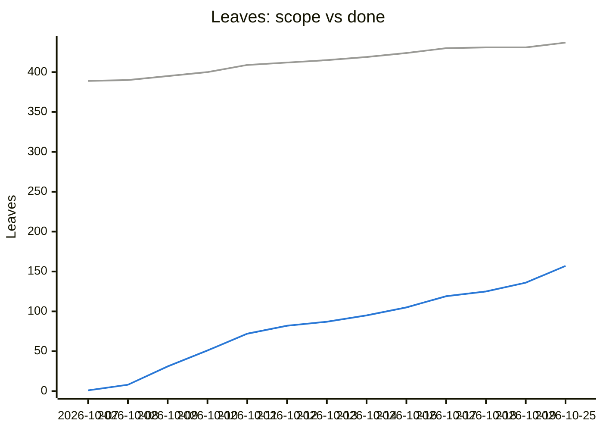

<!-- GENERATED by `cargo xtask progress` from ROADMAP.md. Do not edit by hand. -->
# Persia DB — Progress

**157/437 leaves done (36%)** · 0 in progress · `███████████░░░░░░░░░░░░░░░░░░░` · last snapshot: 2026-10-25

Status lives in [`ROADMAP.md`](./ROADMAP.md) checkboxes (`[ ]` todo · `[~]` in progress · `[x]` done).
After changing one, run `cargo xtask progress --record`.

## Milestone graph

Arrows point from a dependency to the milestone that needs it (implied edges omitted).
✅ done · 🔨 in progress · ▶️ ready (deps done) · ⏳ blocked

```mermaid
flowchart LR
  M0["✅ done<br/><b>M0</b> Project bootstrap<br/>26/26 · 100%"]:::done
  M1["✅ done<br/><b>M1</b> Format primitives<br/>53/53 · 100%"]:::done
  M2["✅ done<br/><b>M2</b> Storage abstraction & local backends<br/>46/46 · 100%"]:::done
  M3["✅ done<br/><b>M3</b> Schema, documents, collections<br/>15/15 · 100%"]:::done
  M4["🔨 in progress<br/><b>M4</b> Text analysis<br/>17/27 · 63%"]:::doing
  M5["⏳ blocked<br/><b>M5</b> Segment writer & reader<br/>0/36 · 0%"]:::blocked
  M6["⏳ blocked<br/><b>M6</b> Write path, durability, merging<br/>0/31 · 0%"]:::blocked
  M7["⏳ blocked<br/><b>M7</b> Query engine & ranking<br/>0/29 · 0%"]:::blocked
  M8["⏳ blocked<br/><b>M8</b> Zero-results avoidance<br/>0/23 · 0%"]:::blocked
  M9["▶️ ready<br/><b>M9</b> Blob store<br/>0/20 · 0%"]:::ready
  M10["⏳ blocked<br/><b>M10</b> Embedded API<br/>0/18 · 0%"]:::blocked
  M11["⏳ blocked<br/><b>M11</b> Server<br/>0/22 · 0%"]:::blocked
  M12["⏳ blocked<br/><b>M12</b> Cloud storage backends<br/>0/29 · 0%"]:::blocked
  M13["⏳ blocked<br/><b>M13</b> Distribution & Kubernetes<br/>0/24 · 0%"]:::blocked
  M14["⏳ blocked<br/><b>M14</b> SDKs<br/>0/17 · 0%"]:::blocked
  M15["⏳ blocked<br/><b>M15</b> Benchmarks, hardening, v1.0<br/>0/21 · 0%"]:::blocked
  M0 --> M1
  M1 --> M2
  M1 --> M3
  M0 --> M4
  M3 --> M5
  M4 --> M5
  M2 --> M6
  M5 --> M6
  M5 --> M7
  M7 --> M8
  M2 --> M9
  M6 --> M10
  M8 --> M10
  M9 --> M10
  M10 --> M11
  M11 --> M12
  M12 --> M13
  M13 --> M14
  M14 --> M15
  classDef done fill:#0ca30c,stroke:#0b0b0b,color:#0b0b0b
  classDef doing fill:#fab219,stroke:#0b0b0b,color:#0b0b0b
  classDef ready fill:#fcfcfb,stroke:#0b0b0b,stroke-width:2px,color:#0b0b0b
  classDef blocked fill:#e8e8e6,stroke:#9a9a96,stroke-dasharray:4 3,color:#52514e
```

## Milestones

| Milestone | State | Progress | Done | Doing | Leaves | Deps |
|---|---|---|--:|--:|--:|---|
| **M0** Project bootstrap | ✅ done | `████████████████████` 100% | 26 | 0 | 26 | — |
| **M1** Format primitives | ✅ done | `████████████████████` 100% | 53 | 0 | 53 | M0 |
| **M2** Storage abstraction & local backends | ✅ done | `████████████████████` 100% | 46 | 0 | 46 | M1 |
| **M3** Schema, documents, collections | ✅ done | `████████████████████` 100% | 15 | 0 | 15 | M1 |
| **M4** Text analysis | 🔨 in progress | `█████████████░░░░░░░` 63% | 17 | 0 | 27 | M0 |
| **M5** Segment writer & reader | ⏳ blocked | `░░░░░░░░░░░░░░░░░░░░` 0% | 0 | 0 | 36 | M1, M3, M4 |
| **M6** Write path, durability, merging | ⏳ blocked | `░░░░░░░░░░░░░░░░░░░░` 0% | 0 | 0 | 31 | M2, M5 |
| **M7** Query engine & ranking | ⏳ blocked | `░░░░░░░░░░░░░░░░░░░░` 0% | 0 | 0 | 29 | M5 |
| **M8** Zero-results avoidance | ⏳ blocked | `░░░░░░░░░░░░░░░░░░░░` 0% | 0 | 0 | 23 | M7 |
| **M9** Blob store | ▶️ ready | `░░░░░░░░░░░░░░░░░░░░` 0% | 0 | 0 | 20 | M1, M2 |
| **M10** Embedded API | ⏳ blocked | `░░░░░░░░░░░░░░░░░░░░` 0% | 0 | 0 | 18 | M6, M7, M8, M9 |
| **M11** Server | ⏳ blocked | `░░░░░░░░░░░░░░░░░░░░` 0% | 0 | 0 | 22 | M10 |
| **M12** Cloud storage backends | ⏳ blocked | `░░░░░░░░░░░░░░░░░░░░` 0% | 0 | 0 | 29 | M2, M6, M9, M11 |
| **M13** Distribution & Kubernetes | ⏳ blocked | `░░░░░░░░░░░░░░░░░░░░` 0% | 0 | 0 | 24 | M11, M12 |
| **M14** SDKs | ⏳ blocked | `░░░░░░░░░░░░░░░░░░░░` 0% | 0 | 0 | 17 | M11, M13 |
| **M15** Benchmarks, hardening, v1.0 | ⏳ blocked | `░░░░░░░░░░░░░░░░░░░░` 0% | 0 | 0 | 21 | M1, M2, M3, M4, M5, M6, M7, M8, M9, M10, M11, M12, M13, M14 |

## In progress

_Nothing in progress._

## Ready next (first 15 todo leaves whose milestone deps are done)

- `4.4.1` `Analyzer` = char filters → tokenizer → token filters; builder + registry by name+version (M4)
- `4.4.2` Built-ins: `standard`, `keyword`, `whitespace`, `en`, `es`, `pt`; SPEC §6.3 lists each one's full chain, its length guard and its folding preserved set (e.g. whether `es` keeps `ñ`, found in the PR #17 review), and whether `en` maps `’` to `'` before stemming (the English stemmer knows only U+0027, found in 4.3) (M4)
- `4.4.3` Analyzer identity/versioning recorded in schema (SPEC §6.3); the schema remembers whether a definition named a version, so evolution binds an unversioned `analyzer` to the current field's version (SPEC §6.2.4) (M4)
- `4.4.4` Zero-allocation fast path (reuse buffers via `TokenStream`) (M4)
- `4.4.5` Benchmark: tokens/sec per analyzer; fuzz: arbitrary UTF-8 never panics (M4)
- `4.4.6` Unicode version bumps (found in the 4.1 review): moving `persia_analysis::UNICODE_VERSION` (unicode-segmentation or toolchain update) bumps the version of every built-in analyzer whose output changes, with a test listing which ones (SPEC §6.3.1) (M4)
- `4.4.7` Char-filter offset mapping (found in the PR #15 review): a char filter that changes the text records an offset map, and the analyzer maps token spans back to the original field value (SPEC §6.3.1); property: spans stay on char boundaries of the original value, strictly increasing (M4)
- `4.4.8` Query-time analysis for fields whose analyzer stacks tokens (found in the 4.2 review): with `edge_ngram`, queries and synonym terms (SPEC §6.3.2) are analyzed without it, or `SynonymMap::find` never matches stacked prefixes; define the query-time analyzer in SPEC §6.3 (M4)
- `4.4.9` Folding fast path (found in the 4.2 review): `FoldingFilter` allocates for every non-ASCII token even when nothing folds; pre-scan for foldable characters, measured by the 4.4.5 benchmark (M4)
- `4.4.10` Built-in `fr`, `de`, `it` analyzers (found in the PR #17 review): SPEC §6.3 lists them but 4.2.4, 4.3 and 4.4.2 plan only `en`, `es`, `pt`; add their stopword lists and stemmers, or scope them out of §6.3 (M4)
- `9.1.0` ADR: blob upload staging and expected-id API (SPEC §18.8); update SPEC §9.3/§9.4/§9.6 (M9)
- `9.1.1` Content hasher per ADR-0002 producing `BlobId` (type from 1.10.1), chunking parameters (M9)
- `9.1.2` Streaming chunker (`Read` → chunks with CRC and running content hash) (M9)
- `9.1.3` Blob manifest (chunk list) encode/decode (M9)
- `9.2.1` Pack header/superblock + `BlobChunk`/`BlobIndex` frames (SPEC §9.3) (M9)
- … and 15 more

## Burn-up

Gray line: total leaves (scope). Blue line: leaves done.

| Date | Done | In progress | Total | Done % |
|---|--:|--:|--:|--:|
| 2026-10-07 | 1 | 2 | 389 | 0% |
| 2026-10-08 | 8 | 2 | 390 | 2% |
| 2026-10-09 | 31 | 0 | 395 | 8% |
| 2026-10-10 | 51 | 0 | 400 | 13% |
| 2026-10-11 | 72 | 0 | 409 | 18% |
| 2026-10-12 | 82 | 0 | 412 | 20% |
| 2026-10-13 | 87 | 0 | 415 | 21% |
| 2026-10-14 | 95 | 0 | 419 | 23% |
| 2026-10-16 | 105 | 11 | 424 | 25% |
| 2026-10-17 | 119 | 0 | 430 | 28% |
| 2026-10-18 | 125 | 0 | 431 | 29% |
| 2026-10-19 | 136 | 0 | 431 | 32% |
| 2026-10-25 | 157 | 0 | 437 | 36% |
