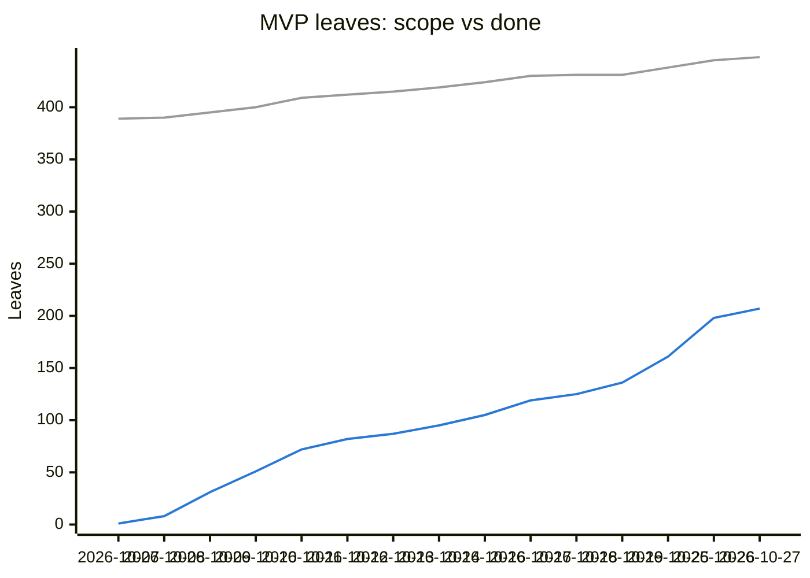

<!-- GENERATED by `cargo xtask progress` from ROADMAP.md. Do not edit by hand. -->
# Persia DB — Progress

**207/448 leaves done (46%)** · 0 in progress · `██████████████░░░░░░░░░░░░░░░░` · last snapshot: 2026-10-27

MVP (M0–M15): the counts above. Post-MVP: **0/151 leaves done (0%)** · 0 in progress. Those leaves are not part of the percentage, the graph, the ready-next list, or the burn-up. In-progress ones are listed under Post-MVP.

Status lives in [`ROADMAP.md`](./ROADMAP.md) checkboxes (`[ ]` todo · `[~]` in progress · `[x]` done).
After changing one, run `cargo xtask progress --record`.

## Milestone graph

Arrows point from a dependency to the milestone that needs it (implied edges omitted).
✅ done · 🔨 in progress · ▶️ ready (deps done) · ⏳ blocked

```mermaid
flowchart LR
  M0["✅ done<br/><b>M0</b> Project bootstrap<br/>26/26 · 100%"]:::done
  M1["✅ done<br/><b>M1</b> Format primitives<br/>53/53 · 100%"]:::done
  M2["✅ done<br/><b>M2</b> Storage abstraction & local backends<br/>46/46 · 100%"]:::done
  M3["✅ done<br/><b>M3</b> Schema, documents, collections<br/>15/15 · 100%"]:::done
  M4["✅ done<br/><b>M4</b> Text analysis<br/>29/29 · 100%"]:::done
  M5["🔨 in progress<br/><b>M5</b> Segment writer & reader<br/>38/44 · 86%"]:::doing
  M6["⏳ blocked<br/><b>M6</b> Write path, durability, merging<br/>0/32 · 0%"]:::blocked
  M7["⏳ blocked<br/><b>M7</b> Query engine & ranking<br/>0/29 · 0%"]:::blocked
  M8["⏳ blocked<br/><b>M8</b> Zero-results avoidance<br/>0/23 · 0%"]:::blocked
  M9["▶️ ready<br/><b>M9</b> Blob store<br/>0/20 · 0%"]:::ready
  M10["⏳ blocked<br/><b>M10</b> Embedded API<br/>0/18 · 0%"]:::blocked
  M11["⏳ blocked<br/><b>M11</b> Server<br/>0/22 · 0%"]:::blocked
  M12["⏳ blocked<br/><b>M12</b> Cloud storage backends<br/>0/29 · 0%"]:::blocked
  M13["⏳ blocked<br/><b>M13</b> Distribution & Kubernetes<br/>0/24 · 0%"]:::blocked
  M14["⏳ blocked<br/><b>M14</b> SDKs<br/>0/17 · 0%"]:::blocked
  M15["⏳ blocked<br/><b>M15</b> Benchmarks, hardening, v1.0<br/>0/21 · 0%"]:::blocked
  M0 --> M1
  M1 --> M2
  M1 --> M3
  M0 --> M4
  M3 --> M5
  M4 --> M5
  M2 --> M6
  M5 --> M6
  M5 --> M7
  M7 --> M8
  M2 --> M9
  M6 --> M10
  M8 --> M10
  M9 --> M10
  M10 --> M11
  M11 --> M12
  M12 --> M13
  M13 --> M14
  M14 --> M15
  classDef done fill:#0ca30c,stroke:#0b0b0b,color:#0b0b0b
  classDef doing fill:#fab219,stroke:#0b0b0b,color:#0b0b0b
  classDef ready fill:#fcfcfb,stroke:#0b0b0b,stroke-width:2px,color:#0b0b0b
  classDef blocked fill:#e8e8e6,stroke:#9a9a96,stroke-dasharray:4 3,color:#52514e
```

## Milestones

| Milestone | State | Progress | Done | Doing | Leaves | Deps |
|---|---|---|--:|--:|--:|---|
| **M0** Project bootstrap | ✅ done | `████████████████████` 100% | 26 | 0 | 26 | — |
| **M1** Format primitives | ✅ done | `████████████████████` 100% | 53 | 0 | 53 | M0 |
| **M2** Storage abstraction & local backends | ✅ done | `████████████████████` 100% | 46 | 0 | 46 | M1 |
| **M3** Schema, documents, collections | ✅ done | `████████████████████` 100% | 15 | 0 | 15 | M1 |
| **M4** Text analysis | ✅ done | `████████████████████` 100% | 29 | 0 | 29 | M0 |
| **M5** Segment writer & reader | 🔨 in progress | `█████████████████░░░` 86% | 38 | 0 | 44 | M1, M3, M4 |
| **M6** Write path, durability, merging | ⏳ blocked | `░░░░░░░░░░░░░░░░░░░░` 0% | 0 | 0 | 32 | M2, M5 |
| **M7** Query engine & ranking | ⏳ blocked | `░░░░░░░░░░░░░░░░░░░░` 0% | 0 | 0 | 29 | M5 |
| **M8** Zero-results avoidance | ⏳ blocked | `░░░░░░░░░░░░░░░░░░░░` 0% | 0 | 0 | 23 | M7 |
| **M9** Blob store | ▶️ ready | `░░░░░░░░░░░░░░░░░░░░` 0% | 0 | 0 | 20 | M1, M2 |
| **M10** Embedded API | ⏳ blocked | `░░░░░░░░░░░░░░░░░░░░` 0% | 0 | 0 | 18 | M6, M7, M8, M9 |
| **M11** Server | ⏳ blocked | `░░░░░░░░░░░░░░░░░░░░` 0% | 0 | 0 | 22 | M10 |
| **M12** Cloud storage backends | ⏳ blocked | `░░░░░░░░░░░░░░░░░░░░` 0% | 0 | 0 | 29 | M2, M6, M9, M11 |
| **M13** Distribution & Kubernetes | ⏳ blocked | `░░░░░░░░░░░░░░░░░░░░` 0% | 0 | 0 | 24 | M11, M12 |
| **M14** SDKs | ⏳ blocked | `░░░░░░░░░░░░░░░░░░░░` 0% | 0 | 0 | 17 | M11, M13 |
| **M15** Benchmarks, hardening, v1.0 | ⏳ blocked | `░░░░░░░░░░░░░░░░░░░░` 0% | 0 | 0 | 21 | M1, M2, M3, M4, M5, M6, M7, M8, M9, M10, M11, M12, M13, M14 |

## Post-MVP

Not included in the headline, the graph, the ready-next list, or the burn-up. In-progress leaves are listed here, not in the MVP list.

| Milestone | State | Progress | Done | Doing | Leaves | Deps |
|---|---|---|--:|--:|--:|---|
| **M16** Embedded SDKs (v1.1) | ⏳ blocked | `░░░░░░░░░░░░░░░░░░░░` 0% | 0 | 0 | 18 | M15 |
| **M17** Highlighting and snippets (v1.1) | ⏳ blocked | `░░░░░░░░░░░░░░░░░░░░` 0% | 0 | 0 | 8 | M7, M15 |
| **M18** Autocomplete (v1.1) | ⏳ blocked | `░░░░░░░░░░░░░░░░░░░░` 0% | 0 | 0 | 8 | M4, M8, M10, M15 |
| **M19** Import (v1.1) | ⏳ blocked | `░░░░░░░░░░░░░░░░░░░░` 0% | 0 | 0 | 11 | M10, M15 |
| **M20** Encryption at rest (v1.2) | ⏳ blocked | `░░░░░░░░░░░░░░░░░░░░` 0% | 0 | 0 | 10 | M2, M12, M15 |
| **M21** Python SDK (v1.2) | ⏳ blocked | `░░░░░░░░░░░░░░░░░░░░` 0% | 0 | 0 | 8 | M14, M16 |
| **M22** Multi-tenant mode (v2.0) | ⏳ blocked | `░░░░░░░░░░░░░░░░░░░░` 0% | 0 | 0 | 8 | M12, M15 |
| **M23** Persia Cloud (v2.0) | ⏳ blocked | `░░░░░░░░░░░░░░░░░░░░` 0% | 0 | 0 | 11 | M13, M20, M22 |
| **M24** CDC connectors (v2.0) | ⏳ blocked | `░░░░░░░░░░░░░░░░░░░░` 0% | 0 | 0 | 11 | M11, M15 |
| **M25** Web dashboard (v2.0) | ⏳ blocked | `░░░░░░░░░░░░░░░░░░░░` 0% | 0 | 0 | 12 | M11, M15 |
| **M26** UI components (v2.1) | ⏳ blocked | `░░░░░░░░░░░░░░░░░░░░` 0% | 0 | 0 | 6 | M11, M17, M18 |
| **M27** AI search (v2.2) | ⏳ blocked | `░░░░░░░░░░░░░░░░░░░░` 0% | 0 | 0 | 14 | M9, M15, M17 |
| **M28** On-device (v2.3) | ⏳ blocked | `░░░░░░░░░░░░░░░░░░░░` 0% | 0 | 0 | 9 | M2, M16 |
| **M29** Geo filters and sorting (v3.0) | ⏳ blocked | `░░░░░░░░░░░░░░░░░░░░` 0% | 0 | 0 | 7 | M7, M15 |
| **M30** Enterprise (v3.0) | ⏳ blocked | `░░░░░░░░░░░░░░░░░░░░` 0% | 0 | 0 | 10 | M13, M20, M22, M25 |

### In progress (post-MVP)

_Nothing in progress._

### Ready (post-MVP)

_Nothing ready._

## In progress (MVP)

_Nothing in progress._

## Ready next (first 15 MVP todo leaves whose milestone deps are done)

- `5.1.6` Flush peak memory (found in the 5.1–5.2 review): `SegmentWriter::finish` holds every section as a `Vec` and copies it into the output, plus the grouped postings and dense norms and keys, so a flush peaks at 2–3× `size_in_bytes`; stream sections to the output (or a `Storage` writer) and document the bound the M6 flush threshold relies on (M5)
- `5.3.11` Decoded-block caching for postings (found in 5.3): `terms()` decodes its TermInfo blocks again on each call, and each `Postings` iterator decodes, and re-verifies the CRC of, the framed blocks it reads; share decoded blocks across iterators and queries (the SPEC §10.6 block cache) and measure it in 5.5.5 (M5)
- `5.3.12` Lazy column access (found in the 5.3 review): `numeric_column` and `keyword_column` decode a whole column into 8 bytes per document; read FOR blocks on demand (SPEC §5.2.1 makes any value O(1)) so a 100M-document segment does not need 800 MB per column (M5)
- `5.3.13` Positions per document (found in the 5.3 review): `Postings::positions` decodes a block's whole positions run (capped at 2^26 values, a resource error beyond); decode only the current document's positions, on demand, so memory stays proportional to one document's term frequency (M5)
- `5.4.5` A maximum term length for `text` fields (found in the 5.5 review): `TermDict` paths are bounded for keyword fields (`MAX_KEYWORD_LEN`) and the `IdMap` (`MAX_ID_LEN`), but a text term is bounded only by the document size (the token length guard is configurable, and a registered analyzer may omit it), so a crafted text `TermDict` sharing one long suffix across all its keys passes the structural check and makes the open-time stream cost keys × path length. Decide a SPEC-wide term cap (e.g. 32 KiB, enforced by the builder and checked at open) or a walk-cost budget, then bound text `TermDict`s in `Segment::max_key_len` (M5)
- `5.4.6` Re-audit `segment/read/fst_check.rs` on every `fst` version bump (found in the 5.5 review): it re-implements fst 0.4.7's node parser to prove fst cannot panic, loop or overflow on a payload it accepts, and `fst` is pinned to `=0.4.7` for that reason; a bump compares the parser and the paths the engine uses (`get`, streams, range and automaton search) with the new code, re-runs the `fst_check` tests and fuzzes `segment` (M5)
- `9.1.0` ADR: blob upload staging and expected-id API (SPEC §18.8); update SPEC §9.3/§9.4/§9.6 (M9)
- `9.1.1` Content hasher per ADR-0002 producing `BlobId` (type from 1.10.1), chunking parameters (M9)
- `9.1.2` Streaming chunker (`Read` → chunks with CRC and running content hash) (M9)
- `9.1.3` Blob manifest (chunk list) encode/decode (M9)
- `9.2.1` Pack header/superblock + `BlobChunk`/`BlobIndex` frames (SPEC §9.3) (M9)
- `9.2.2` Append blob (dedup check by id), fsync policy (M9)
- `9.2.3` Read full / range via chunk index (mmap-backed) (M9)
- `9.2.4` Recovery: torn tail truncation, index rebuild by scan (M9)
- `9.2.5` Fuzz pack reader (M9)
- … and 11 more

## Burn-up

Gray line: total MVP leaves (M0–M15 scope). Blue line: MVP leaves done. Post-MVP leaves are not on this chart.

| Date | Done | In progress | Total | Done % |
|---|--:|--:|--:|--:|
| 2026-10-07 | 1 | 2 | 389 | 0% |
| 2026-10-08 | 8 | 2 | 390 | 2% |
| 2026-10-09 | 31 | 0 | 395 | 8% |
| 2026-10-10 | 51 | 0 | 400 | 13% |
| 2026-10-11 | 72 | 0 | 409 | 18% |
| 2026-10-12 | 82 | 0 | 412 | 20% |
| 2026-10-13 | 87 | 0 | 415 | 21% |
| 2026-10-14 | 95 | 0 | 419 | 23% |
| 2026-10-16 | 105 | 11 | 424 | 25% |
| 2026-10-17 | 119 | 0 | 430 | 28% |
| 2026-10-18 | 125 | 0 | 431 | 29% |
| 2026-10-19 | 136 | 0 | 431 | 32% |
| 2026-10-25 | 161 | 0 | 438 | 37% |
| 2026-10-26 | 198 | 0 | 445 | 44% |
| 2026-10-27 | 207 | 0 | 448 | 46% |
