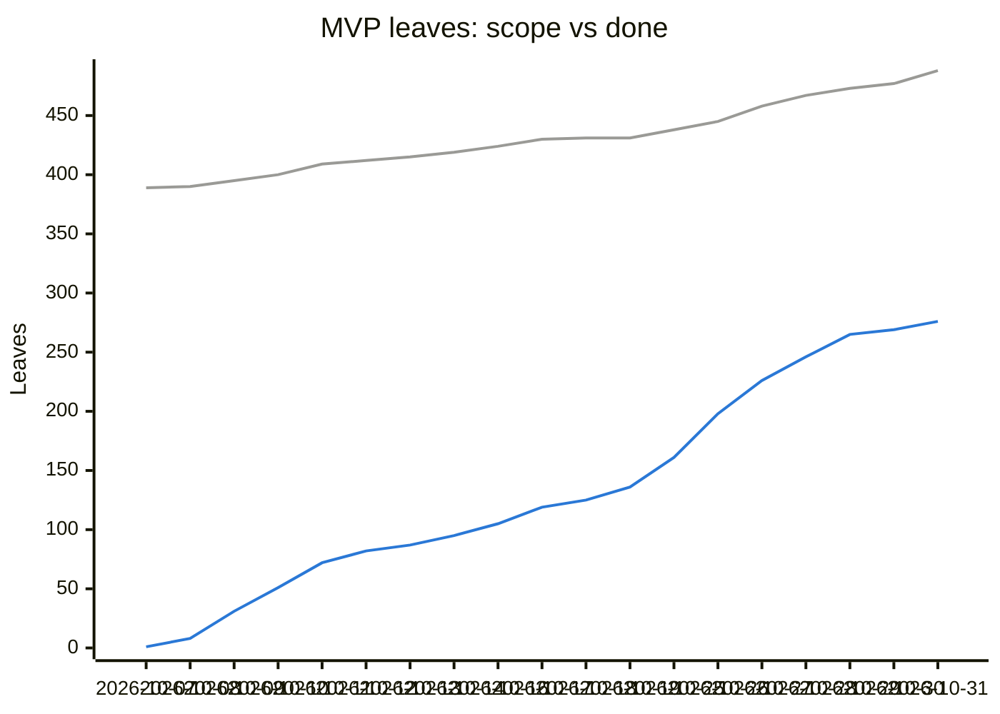

<!-- GENERATED by `cargo xtask progress` from ROADMAP.md. Do not edit by hand. -->
# Persia DB — Progress

**276/488 leaves done (57%)** · 0 in progress · `█████████████████░░░░░░░░░░░░░` · last snapshot: 2026-10-31

MVP (M0–M15): the counts above. Post-MVP: **0/177 leaves done (0%)** · 0 in progress. Those leaves are not part of the percentage, the graph, the ready-next list, or the burn-up. In-progress ones are listed under Post-MVP.

Status lives in [`ROADMAP.md`](./ROADMAP.md) checkboxes (`[ ]` todo · `[~]` in progress · `[x]` done).
After changing one, run `cargo xtask progress --record`.

## Milestone graph

Arrows point from a dependency to the milestone that needs it (implied edges omitted).
✅ done · 🔨 in progress · ▶️ ready (deps done) · ⏳ blocked

```mermaid
flowchart LR
  M0["✅ done<br/><b>M0</b> Project bootstrap<br/>26/26 · 100%"]:::done
  M1["✅ done<br/><b>M1</b> Format primitives<br/>53/53 · 100%"]:::done
  M2["✅ done<br/><b>M2</b> Storage abstraction & local backends<br/>46/46 · 100%"]:::done
  M3["✅ done<br/><b>M3</b> Schema, documents, collections<br/>15/15 · 100%"]:::done
  M4["✅ done<br/><b>M4</b> Text analysis<br/>29/29 · 100%"]:::done
  M5["✅ done<br/><b>M5</b> Segment writer & reader<br/>48/48 · 100%"]:::done
  M6["🔨 in progress<br/><b>M6</b> Write path, durability, merging<br/>39/51 · 76%"]:::doing
  M7["🔨 in progress<br/><b>M7</b> Query engine & ranking<br/>20/38 · 53%"]:::doing
  M8["⏳ blocked<br/><b>M8</b> Zero-results avoidance<br/>0/27 · 0%"]:::blocked
  M9["▶️ ready<br/><b>M9</b> Blob store<br/>0/20 · 0%"]:::ready
  M10["⏳ blocked<br/><b>M10</b> Embedded API<br/>0/19 · 0%"]:::blocked
  M11["⏳ blocked<br/><b>M11</b> Server<br/>0/23 · 0%"]:::blocked
  M12["⏳ blocked<br/><b>M12</b> Cloud storage backends<br/>0/29 · 0%"]:::blocked
  M13["⏳ blocked<br/><b>M13</b> Distribution & Kubernetes<br/>0/24 · 0%"]:::blocked
  M14["⏳ blocked<br/><b>M14</b> SDKs<br/>0/19 · 0%"]:::blocked
  M15["⏳ blocked<br/><b>M15</b> Benchmarks, hardening, v1.0<br/>0/21 · 0%"]:::blocked
  M0 --> M1
  M1 --> M2
  M1 --> M3
  M0 --> M4
  M3 --> M5
  M4 --> M5
  M2 --> M6
  M5 --> M6
  M5 --> M7
  M7 --> M8
  M2 --> M9
  M6 --> M10
  M8 --> M10
  M9 --> M10
  M10 --> M11
  M11 --> M12
  M12 --> M13
  M13 --> M14
  M14 --> M15
  classDef done fill:#0ca30c,stroke:#0b0b0b,color:#0b0b0b
  classDef doing fill:#fab219,stroke:#0b0b0b,color:#0b0b0b
  classDef ready fill:#fcfcfb,stroke:#0b0b0b,stroke-width:2px,color:#0b0b0b
  classDef blocked fill:#e8e8e6,stroke:#9a9a96,stroke-dasharray:4 3,color:#52514e
```

## Milestones

| Milestone | State | Progress | Done | Doing | Leaves | Deps |
|---|---|---|--:|--:|--:|---|
| **M0** Project bootstrap | ✅ done | `████████████████████` 100% | 26 | 0 | 26 | — |
| **M1** Format primitives | ✅ done | `████████████████████` 100% | 53 | 0 | 53 | M0 |
| **M2** Storage abstraction & local backends | ✅ done | `████████████████████` 100% | 46 | 0 | 46 | M1 |
| **M3** Schema, documents, collections | ✅ done | `████████████████████` 100% | 15 | 0 | 15 | M1 |
| **M4** Text analysis | ✅ done | `████████████████████` 100% | 29 | 0 | 29 | M0 |
| **M5** Segment writer & reader | ✅ done | `████████████████████` 100% | 48 | 0 | 48 | M1, M3, M4 |
| **M6** Write path, durability, merging | 🔨 in progress | `███████████████░░░░░` 76% | 39 | 0 | 51 | M2, M5 |
| **M7** Query engine & ranking | 🔨 in progress | `███████████░░░░░░░░░` 53% | 20 | 0 | 38 | M5 |
| **M8** Zero-results avoidance | ⏳ blocked | `░░░░░░░░░░░░░░░░░░░░` 0% | 0 | 0 | 27 | M7 |
| **M9** Blob store | ▶️ ready | `░░░░░░░░░░░░░░░░░░░░` 0% | 0 | 0 | 20 | M1, M2 |
| **M10** Embedded API | ⏳ blocked | `░░░░░░░░░░░░░░░░░░░░` 0% | 0 | 0 | 19 | M6, M7, M8, M9 |
| **M11** Server | ⏳ blocked | `░░░░░░░░░░░░░░░░░░░░` 0% | 0 | 0 | 23 | M10 |
| **M12** Cloud storage backends | ⏳ blocked | `░░░░░░░░░░░░░░░░░░░░` 0% | 0 | 0 | 29 | M2, M6, M9, M11 |
| **M13** Distribution & Kubernetes | ⏳ blocked | `░░░░░░░░░░░░░░░░░░░░` 0% | 0 | 0 | 24 | M11, M12 |
| **M14** SDKs | ⏳ blocked | `░░░░░░░░░░░░░░░░░░░░` 0% | 0 | 0 | 19 | M11, M13 |
| **M15** Benchmarks, hardening, v1.0 | ⏳ blocked | `░░░░░░░░░░░░░░░░░░░░` 0% | 0 | 0 | 21 | M1, M2, M3, M4, M5, M6, M7, M8, M9, M10, M11, M12, M13, M14 |

## Post-MVP

Not included in the headline, the graph, the ready-next list, or the burn-up. In-progress leaves are listed here, not in the MVP list.

| Milestone | State | Progress | Done | Doing | Leaves | Deps |
|---|---|---|--:|--:|--:|---|
| **M16** Embedded SDKs (v1.1) | ⏳ blocked | `░░░░░░░░░░░░░░░░░░░░` 0% | 0 | 0 | 19 | M15 |
| **M17** Highlighting and snippets (v1.1) | ⏳ blocked | `░░░░░░░░░░░░░░░░░░░░` 0% | 0 | 0 | 8 | M7, M15 |
| **M18** Autocomplete (v1.1) | ⏳ blocked | `░░░░░░░░░░░░░░░░░░░░` 0% | 0 | 0 | 8 | M4, M8, M10, M15 |
| **M19** Import (v1.1) | ⏳ blocked | `░░░░░░░░░░░░░░░░░░░░` 0% | 0 | 0 | 11 | M10, M15 |
| **M20** Encryption at rest (v1.2) | ⏳ blocked | `░░░░░░░░░░░░░░░░░░░░` 0% | 0 | 0 | 10 | M2, M12, M15 |
| **M21** Python SDK (v1.2) | ⏳ blocked | `░░░░░░░░░░░░░░░░░░░░` 0% | 0 | 0 | 8 | M14, M16 |
| **M22** Multi-tenant mode (v2.0) | ⏳ blocked | `░░░░░░░░░░░░░░░░░░░░` 0% | 0 | 0 | 8 | M12, M15 |
| **M23** Persia Cloud (v2.0) | ⏳ blocked | `░░░░░░░░░░░░░░░░░░░░` 0% | 0 | 0 | 11 | M13, M20, M22 |
| **M24** CDC connectors (v2.0) | ⏳ blocked | `░░░░░░░░░░░░░░░░░░░░` 0% | 0 | 0 | 11 | M11, M15 |
| **M25** Web dashboard (v2.0) | ⏳ blocked | `░░░░░░░░░░░░░░░░░░░░` 0% | 0 | 0 | 12 | M11, M15 |
| **M26** UI components (v2.1) | ⏳ blocked | `░░░░░░░░░░░░░░░░░░░░` 0% | 0 | 0 | 6 | M11, M17, M18 |
| **M27** AI search (v2.2) | ⏳ blocked | `░░░░░░░░░░░░░░░░░░░░` 0% | 0 | 0 | 15 | M9, M15, M17 |
| **M28** On-device (v2.3) | ⏳ blocked | `░░░░░░░░░░░░░░░░░░░░` 0% | 0 | 0 | 9 | M2, M16 |
| **M29** Geo filters and sorting (v3.0) | ⏳ blocked | `░░░░░░░░░░░░░░░░░░░░` 0% | 0 | 0 | 7 | M7, M15 |
| **M30** Enterprise (v3.0) | ⏳ blocked | `░░░░░░░░░░░░░░░░░░░░` 0% | 0 | 0 | 10 | M13, M20, M22, M25 |
| **M31** Persia Studio (v1.1) | ⏳ blocked | `░░░░░░░░░░░░░░░░░░░░` 0% | 0 | 0 | 13 | M16 |
| **M32** Ranking rules (v1.1) | ⏳ blocked | `░░░░░░░░░░░░░░░░░░░░` 0% | 0 | 0 | 4 | M7, M8, M15 |
| **M33** Search features (v1.1) | ⏳ blocked | `░░░░░░░░░░░░░░░░░░░░` 0% | 0 | 0 | 5 | M4, M6, M7, M15 |
| **M34** Backup, export, and query analytics (v1.2) | ⏳ blocked | `░░░░░░░░░░░░░░░░░░░░` 0% | 0 | 0 | 2 | M8, M10, M15 |

### In progress (post-MVP)

_Nothing in progress._

### Ready (post-MVP)

_Nothing ready._

## In progress (MVP)

_Nothing in progress._

## Ready next (first 15 MVP todo leaves whose milestone deps are done)

- `6.1.6` Undo a failed `put` without rehashing the term arenas: `Arena::truncate` rebuilds the whole table under the write lock, O(terms) per rejected document (found in the 6.1 review) (M6)
- `6.1.7` Cache `MemtableView::df` if term statistics become hot: it walks the posting chain under the read lock on every call. The count is the view's `(docs, version)` cutoff, so it cannot reuse a live counter on the term, and a cache has to be keyed by that cutoff and bounded (found in 7.2) (M6)
- `6.3.11` Flush without re-indexing: build the segment from the memtable's postings instead of analyzing every document again (ADR-0029, found in 6.3.1); bench the flush before and after (M6)
- `6.4.5` Prune the commit's tombstone lookups by each segment's footer id range (`Segment::id_range`), once open or `Segment::verify` checks `min_id`/`max_id` against the `IdMap` (a wrong range would leave an older copy live). Helps time-ordered ids only; random ids (UUIDs) span every range. Bench `commit_inserts_*` before and after (found in 6.4.3: 64 segments double a 2 000-document commit) (M6)
- `6.4.7` Per-segment id membership filter (e.g. a Bloom filter section) so a commit skips segments that cannot hold an id, for random ids that id ranges do not prune; a format change (SPEC §5.3, ADR, golden file) (found in the 6.4 review) (M6)
- `6.5.6` Streaming merge writer: encode the merged sections while the inputs are read, so a merge holds no more than a block per section instead of the whole merged segment in a `SegmentBuilder` (ADR-0031 item 8, found in 6.5.2) (M6)
- `6.5.7` Merge throughput: a merge-only postings reader that decodes whole lists (no per-term `Postings` cursor), and regrouping without a sort; goal: `segment_merge/copy_8` faster than `segment/add` on the same run (internal bench, `docs/benchmarks.md`; not a claim, BENCHMARKS.md) (M6)
- `6.5.8` Engine-driven container compaction (SPEC §4.6): `Database` names the live frames (the manifest's, plus the obsolete frames still referenced, 6.5.4) and the WAL range, compacts when dead space reaches the ratio, and publishes the relocated manifest (`Manifest::relocate`) (found in 6.5.4) (M6)
- `6.5.9` Merges that survive concurrent deletes: re-apply the deletions committed to its inputs since the plan to the merged segment (a docid map kept with the result) instead of discarding it (ADR-0032 item 4, found in 6.5.3) (M6)
- `6.6.6` Refresh a `ReadOnlyDatabase` in place: a new snapshot from the next manifest and the WAL frames written since, instead of a reopen (ADR-0033 Alternatives, found in 6.6.2) (M6)
- `6.6.8` `persia verify` with custom analyzers, once a schema can name an analyzer registered with `AnalyzerRegistry::register` (today `AnalyzerRef` accepts built-ins only, SPEC §6.2.2): a way to load them in the CLI, or a replay that validates records without analyzing their `text` fields (found in 6.6.7) (M6)
- `6.6.10` `persia inspect container` (CLI, read-only): the superblock (`seq`, `wal_start`, `log_end`), every frame from `wal_start` (kind, offset, length, `frame_seq`, whether after `log_end`), Manifest frames after `log_end` with their `seq`, and with `--id` the WAL records naming a document id. Replaces the throwaway debug test the 6.6.9 triage needed (crash-triage skill) (M6)
- `7.3.5` (v1.0) Term proximity scoring: a bonus from the minimum span, or the pair distance, of the query terms, using positions already indexed (5.3.4). The bonus must keep pruning bounds valid (MaxScore and block-max WAND, SPEC §7.2, §7.3) (M7)
- `7.4.7` A disjunction for many clauses (relaxation expansions, SPEC §7.6: up to 50 prefix or fuzzy terms): a heap instead of a scan of every clause per document, and phrase candidates that copy positions only while starts survive; bench `search_top10/or` with 50 clauses before and after (found in the 7.4 review) (M7)
- `7.4.8` Prune conjunctions and `should` clauses beside `must` with block bounds (block-max AND, required plus optional as Lucene's ReqOpt): today a threshold reaches only a term, a pure `should` disjunction and what `must_not`/`boost` wrap (SPEC §7.3, found in 7.4.4) (M7)
- … and 35 more

## Burn-up

Gray line: total MVP leaves (M0–M15 scope). Blue line: MVP leaves done. Post-MVP leaves are not on this chart.

| Date | Done | In progress | Total | Done % |
|---|--:|--:|--:|--:|
| 2026-10-07 | 1 | 2 | 389 | 0% |
| 2026-10-08 | 8 | 2 | 390 | 2% |
| 2026-10-09 | 31 | 0 | 395 | 8% |
| 2026-10-10 | 51 | 0 | 400 | 13% |
| 2026-10-11 | 72 | 0 | 409 | 18% |
| 2026-10-12 | 82 | 0 | 412 | 20% |
| 2026-10-13 | 87 | 0 | 415 | 21% |
| 2026-10-14 | 95 | 0 | 419 | 23% |
| 2026-10-16 | 105 | 11 | 424 | 25% |
| 2026-10-17 | 119 | 0 | 430 | 28% |
| 2026-10-18 | 125 | 0 | 431 | 29% |
| 2026-10-19 | 136 | 0 | 431 | 32% |
| 2026-10-25 | 161 | 0 | 438 | 37% |
| 2026-10-26 | 198 | 0 | 445 | 44% |
| 2026-10-27 | 226 | 0 | 458 | 49% |
| 2026-10-28 | 246 | 0 | 467 | 53% |
| 2026-10-29 | 265 | 0 | 473 | 56% |
| 2026-10-30 | 269 | 0 | 477 | 56% |
| 2026-10-31 | 276 | 0 | 488 | 57% |
