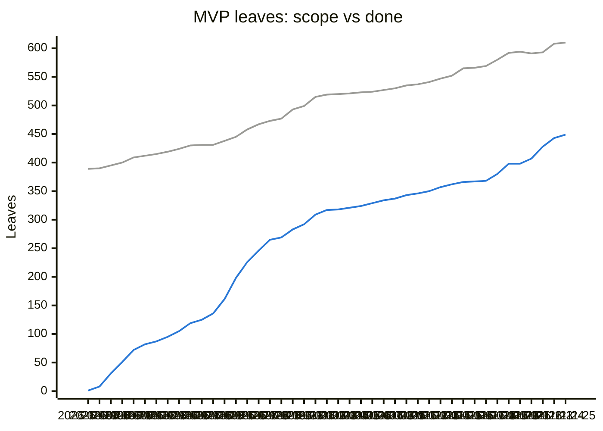

<!-- GENERATED by `cargo xtask progress` from ROADMAP.md. Do not edit by hand. -->
# Persia DB — Progress

**449/610 leaves done (74%)** · 0 in progress · `██████████████████████░░░░░░░░` · last snapshot: 2026-11-25

MVP (M0–M15): the counts above. Post-MVP: **0/226 leaves done (0%)** · 0 in progress. Those leaves are not part of the percentage, the graph, the ready-next list, or the burn-up. In-progress ones are listed under Post-MVP.

Status lives in [`ROADMAP.md`](./ROADMAP.md) checkboxes (`[ ]` todo · `[~]` in progress · `[x]` done).
After changing one, run `cargo xtask progress --record`.

## Milestone graph

Arrows point from a dependency to the milestone that needs it (implied edges omitted).
✅ done · 🔨 in progress · ▶️ ready (deps done) · ⏳ blocked

```mermaid
flowchart LR
  M0["🔨 in progress<br/><b>M0</b> Project bootstrap<br/>36/37 · 97%"]:::doing
  M1["✅ done<br/><b>M1</b> Format primitives<br/>53/53 · 100%"]:::done
  M2["✅ done<br/><b>M2</b> Storage abstraction & local backends<br/>48/48 · 100%"]:::done
  M3["✅ done<br/><b>M3</b> Schema, documents, collections<br/>15/15 · 100%"]:::done
  M4["✅ done<br/><b>M4</b> Text analysis<br/>29/29 · 100%"]:::done
  M5["✅ done<br/><b>M5</b> Segment writer & reader<br/>48/48 · 100%"]:::done
  M6["✅ done<br/><b>M6</b> Write path, durability, merging<br/>52/52 · 100%"]:::done
  M7["✅ done<br/><b>M7</b> Query engine & ranking<br/>51/51 · 100%"]:::done
  M8["✅ done<br/><b>M8</b> Zero-results avoidance<br/>55/55 · 100%"]:::done
  M9["✅ done<br/><b>M9</b> Blob store<br/>44/44 · 100%"]:::done
  M10["🔨 in progress<br/><b>M10</b> Embedded API<br/>18/37 · 49%"]:::doing
  M11["⏳ blocked<br/><b>M11</b> Server<br/>0/24 · 0%"]:::blocked
  M12["⏳ blocked<br/><b>M12</b> Cloud storage backends<br/>0/29 · 0%"]:::blocked
  M13["⏳ blocked<br/><b>M13</b> Distribution & Kubernetes<br/>0/33 · 0%"]:::blocked
  M14["⏳ blocked<br/><b>M14</b> SDKs<br/>0/30 · 0%"]:::blocked
  M15["⏳ blocked<br/><b>M15</b> Benchmarks, hardening, v1.0<br/>0/25 · 0%"]:::blocked
  M0 --> M1
  M1 --> M2
  M1 --> M3
  M0 --> M4
  M3 --> M5
  M4 --> M5
  M2 --> M6
  M5 --> M6
  M5 --> M7
  M7 --> M8
  M2 --> M9
  M6 --> M10
  M8 --> M10
  M9 --> M10
  M10 --> M11
  M11 --> M12
  M12 --> M13
  M13 --> M14
  M14 --> M15
  classDef done fill:#0ca30c,stroke:#0b0b0b,color:#0b0b0b
  classDef doing fill:#fab219,stroke:#0b0b0b,color:#0b0b0b
  classDef ready fill:#fcfcfb,stroke:#0b0b0b,stroke-width:2px,color:#0b0b0b
  classDef blocked fill:#e8e8e6,stroke:#9a9a96,stroke-dasharray:4 3,color:#52514e
```

## Milestones

| Milestone | State | Progress | Done | Doing | Leaves | Deps |
|---|---|---|--:|--:|--:|---|
| **M0** Project bootstrap | 🔨 in progress | `███████████████████░` 97% | 36 | 0 | 37 | — |
| **M1** Format primitives | ✅ done | `████████████████████` 100% | 53 | 0 | 53 | M0 |
| **M2** Storage abstraction & local backends | ✅ done | `████████████████████` 100% | 48 | 0 | 48 | M1 |
| **M3** Schema, documents, collections | ✅ done | `████████████████████` 100% | 15 | 0 | 15 | M1 |
| **M4** Text analysis | ✅ done | `████████████████████` 100% | 29 | 0 | 29 | M0 |
| **M5** Segment writer & reader | ✅ done | `████████████████████` 100% | 48 | 0 | 48 | M1, M3, M4 |
| **M6** Write path, durability, merging | ✅ done | `████████████████████` 100% | 52 | 0 | 52 | M2, M5 |
| **M7** Query engine & ranking | ✅ done | `████████████████████` 100% | 51 | 0 | 51 | M5 |
| **M8** Zero-results avoidance | ✅ done | `████████████████████` 100% | 55 | 0 | 55 | M7 |
| **M9** Blob store | ✅ done | `████████████████████` 100% | 44 | 0 | 44 | M1, M2 |
| **M10** Embedded API | 🔨 in progress | `██████████░░░░░░░░░░` 49% | 18 | 0 | 37 | M6, M7, M8, M9 |
| **M11** Server | ⏳ blocked | `░░░░░░░░░░░░░░░░░░░░` 0% | 0 | 0 | 24 | M10 |
| **M12** Cloud storage backends | ⏳ blocked | `░░░░░░░░░░░░░░░░░░░░` 0% | 0 | 0 | 29 | M2, M6, M9, M11 |
| **M13** Distribution & Kubernetes | ⏳ blocked | `░░░░░░░░░░░░░░░░░░░░` 0% | 0 | 0 | 33 | M11, M12 |
| **M14** SDKs | ⏳ blocked | `░░░░░░░░░░░░░░░░░░░░` 0% | 0 | 0 | 30 | M11, M13 |
| **M15** Benchmarks, hardening, v1.0 | ⏳ blocked | `░░░░░░░░░░░░░░░░░░░░` 0% | 0 | 0 | 25 | M1, M2, M3, M4, M5, M6, M7, M8, M9, M10, M11, M12, M13, M14 |

## Post-MVP

Not included in the headline, the graph, the ready-next list, or the burn-up. In-progress leaves are listed here, not in the MVP list.

| Milestone | State | Progress | Done | Doing | Leaves | Deps |
|---|---|---|--:|--:|--:|---|
| **M16** Embedded SDKs (v1.1) | ⏳ blocked | `░░░░░░░░░░░░░░░░░░░░` 0% | 0 | 0 | 21 | M15 |
| **M17** Highlighting and snippets (v1.1) | ⏳ blocked | `░░░░░░░░░░░░░░░░░░░░` 0% | 0 | 0 | 8 | M7, M15 |
| **M18** Autocomplete (v1.1) | ⏳ blocked | `░░░░░░░░░░░░░░░░░░░░` 0% | 0 | 0 | 8 | M4, M8, M10, M15 |
| **M19** Import (v1.1) | ⏳ blocked | `░░░░░░░░░░░░░░░░░░░░` 0% | 0 | 0 | 11 | M10, M15 |
| **M20** Encryption at rest (v1.2) | ⏳ blocked | `░░░░░░░░░░░░░░░░░░░░` 0% | 0 | 0 | 10 | M2, M12, M15 |
| **M21** Python SDK (v1.2) | ⏳ blocked | `░░░░░░░░░░░░░░░░░░░░` 0% | 0 | 0 | 8 | M14, M16 |
| **M22** Multi-tenant mode (v2.0) | ⏳ blocked | `░░░░░░░░░░░░░░░░░░░░` 0% | 0 | 0 | 8 | M12, M15 |
| **M23** Persia Cloud (v2.0) | ⏳ blocked | `░░░░░░░░░░░░░░░░░░░░` 0% | 0 | 0 | 11 | M13, M20, M22 |
| **M24** CDC connectors (v2.0) | ⏳ blocked | `░░░░░░░░░░░░░░░░░░░░` 0% | 0 | 0 | 11 | M11, M15 |
| **M25** Web dashboard (v2.0) | ⏳ blocked | `░░░░░░░░░░░░░░░░░░░░` 0% | 0 | 0 | 12 | M11, M15 |
| **M26** UI components (v2.1) | ⏳ blocked | `░░░░░░░░░░░░░░░░░░░░` 0% | 0 | 0 | 6 | M11, M17, M18 |
| **M27** AI search (v2.2) | ⏳ blocked | `░░░░░░░░░░░░░░░░░░░░` 0% | 0 | 0 | 15 | M9, M15, M17 |
| **M28** On-device (v2.3) | ⏳ blocked | `░░░░░░░░░░░░░░░░░░░░` 0% | 0 | 0 | 9 | M2, M16 |
| **M29** Geo filters and sorting (v3.0) | ⏳ blocked | `░░░░░░░░░░░░░░░░░░░░` 0% | 0 | 0 | 7 | M7, M15 |
| **M30** Enterprise (v3.0) | ⏳ blocked | `░░░░░░░░░░░░░░░░░░░░` 0% | 0 | 0 | 10 | M13, M20, M22, M25 |
| **M31** Persia Studio (v1.1) | ⏳ blocked | `░░░░░░░░░░░░░░░░░░░░` 0% | 0 | 0 | 15 | M16 |
| **M32** Ranking rules (v1.1) | ⏳ blocked | `░░░░░░░░░░░░░░░░░░░░` 0% | 0 | 0 | 5 | M7, M8, M15 |
| **M33** Search features (v1.1) | ⏳ blocked | `░░░░░░░░░░░░░░░░░░░░` 0% | 0 | 0 | 6 | M4, M6, M7, M15 |
| **M34** Backup, export, and query analytics (v1.2) | ⏳ blocked | `░░░░░░░░░░░░░░░░░░░░` 0% | 0 | 0 | 2 | M8, M10, M15 |
| **M35** Formal verification (v1.1) | ▶️ ready | `░░░░░░░░░░░░░░░░░░░░` 0% | 0 | 0 | 10 | M1 |
| **M36** Search aggregations and derived fields (v1.1) | ▶️ ready | `░░░░░░░░░░░░░░░░░░░░` 0% | 0 | 0 | 9 | M5, M7 |

### Later-version leaves in MVP milestones

Labelled with a version after v1.0, so they count here and do not hold their milestone open.

- [ ] `6.1.7` Cache `MemtableView::df` if term statistics become hot: it walks the posting chain under the read lock on every call. The count is the view's `(docs, version)` cutoff, so it cannot reuse a live counter on the term, and a cache has to be keyed by that cutoff and bounded (found in 7.2) (v1.1) (M6)
- [ ] `6.3.11` Flush without re-indexing: build the segment from the memtable's postings instead of analyzing every document again (ADR-0029, found in 6.3.1); bench the flush before and after (v1.1) (M6)
- [ ] `6.4.5` Prune the commit's tombstone lookups by each segment's footer id range (`Segment::id_range`), once open or `Segment::verify` checks `min_id`/`max_id` against the `IdMap` (a wrong range would leave an older copy live). Helps time-ordered ids only; random ids (UUIDs) span every range. Bench `commit_inserts_*` before and after (found in 6.4.3: 64 segments double a 2 000-document commit) (v1.1) (M6)
- [ ] `6.4.7` Per-segment id membership filter (e.g. a Bloom filter section) so a commit skips segments that cannot hold an id, for random ids that id ranges do not prune; a format change (SPEC §5.3, ADR, golden file) (found in the 6.4 review) (v1.1) (M6)
- [ ] `6.5.6` Streaming merge writer: encode the merged sections while the inputs are read, so a merge holds no more than a block per section instead of the whole merged segment in a `SegmentBuilder` (ADR-0031 item 8, found in 6.5.2) (v1.1) (M6)
- [ ] `6.5.7` Merge throughput: a merge-only postings reader that decodes whole lists (no per-term `Postings` cursor), and regrouping without a sort; goal: `segment_merge/copy_8` faster than `segment/add` on the same run (internal bench, `docs/benchmarks.md`; not a claim, BENCHMARKS.md) (v1.1) (M6)
- [ ] `6.6.12` (v1.1) Detect a registered analyzer whose chain changed under the same version: a stored fingerprint of each registered analyzer version's output on a fixed probe text, checked at open (today a caller who changes a chain without a new version, or ignores a `RegisterError::Reserved` after a release adds that built-in name, opens the database with another chain unnoticed; ADR-0059 Consequences). A format change (a schema option or a manifest field), so the 4-step discipline (found in 6.6.8) (M6)
- [ ] `6.6.13` (v1.1) `ReadOnlyBlobDatabase::refresh` in place: refresh the documents with `ReadOnlyDatabase::refresh` (ADR-0060) instead of a new open, keeping the pairing with the pack refresh and the reader lease (ADR-0054); today its `database()` exposes the engine's refresh, which advances the documents without the pack (documented) (found in 6.6.6) (M6)
- [ ] `6.6.14` (v1.1) Incremental refresh across a flush of replayed records: keep the unchanged segments and rebuild only the memtables from the new `wal_start`, if a measured replica workload needs it (ADR-0060 Alternatives, found in 6.6.6) (M6)
- [ ] `8.1.28` (v1.1) A default field whose analyzer stacks tokens in the differential suite: the reference models an `edge_ngram` field's index (stacked grams at one position, counted in the field length and `tf` as the engine counts them) and skips it at L3 and L4 as `tests/relax_stacking.rs` does (found in 8.1.23) (M8)
- [ ] `8.1.29` (v1.1) A step cut to fit the limits (SPEC §7.1.3) that lowers an expansion below an excluded one it subsumed counts that one again in full, and is cut with no credit (ROADMAP 8.2.12): cut the caps that subsume an exclusion no lower than it first, so such a step keeps more of its own expansions (found in 8.2.12) (M8)
- [ ] `8.1.30` (v1.1) The differential suite generates hard filters beside its soft one (the case's filter is passed as `soft_filter` or marked soft today, so its reference of L6 is unchanged): hard filters are covered by `tests/relax_hard_filters.rs`'s own oracle, not by the reference model (found in 8.2.13) (M8)
- [ ] `8.1.31` (v1.1) A relaxed response says when its facets are partial: the budget passed in a step a page searched only to count its facets (SPEC §7.5), so the page is whole but the counts miss later steps; today nothing flags it (e.g. a `facets_truncated` flag beside `truncated`, found in the 8.1.9 batch review) (M8)
- [ ] `8.1.32` (v1.1) Count a `fill` page's facets with fewer passes: L5 covers every earlier step (`covers_earlier`), so the union of the steps through L5 is L5's selection, and counting that once, unscored, gives the same counts as searching L2's later rungs, L3 and L4 with every match visited (bench `search_relaxed/facets/fill`: 1.39 → 12.8 ms for a first `fill` page with facets since 8.1.9; ADR-0061 Consequences, found in the 8.1.9 re-review) (M8)
- [ ] `8.2.8` (v1.1) A durable per-document index order for L5 `fallback`'s recency (SPEC §7.6, ADR-0044): today recency is index location (memtable, then segments newest first, docids descending), which a merge reorders, as its output is added after the kept segments (§8.5). Record each document's write order (for example the commit `seq` of its write, as a hidden column written at flush and copied through merges) so recency is write time and merge-stable. An on-disk format change: SPEC, version or feature flag, ADR and golden fixture (found in 8.2.5) (M8)
- [ ] `8.2.9` (v1.1) L5 `fallback` by static rank reads every candidate's column key when the FOR bounds (the minimum plus `2^width − 1`, SPEC §5.2.1) do not separate blocks: values spread over their range (the bench's prices) give every block the same bound, so `search_relaxed/l5/static_rank` reads all 50 000 keys (886 µs, ADR-0044). Store an exact maximum per block, or a per-segment order by static rank written at flush (both on-disk format changes), or cache L5's order per snapshot. Each block visited, and each window a recency walk reads back, builds the step's matcher again, which looks up the postings of every earlier step it excludes (after the default levels, the L2 ladder and the L3 and L4 expansions): measure L5 after the default levels too (found in 8.2.5) (M8)
- [ ] `8.2.10` (v1.1) Exact above stemmed within a level (ROADMAP 8.2.7, ADR-0046 item 6): a word matched as typed ranks above one matched only by its stem. The index holds the stems alone, so this needs an unstemmed form per token (for example a hidden exact-form term beside each stemmed one at flush, copied through merges): an on-disk format change (SPEC, version or feature flag, ADR and golden fixture), then a tier step of L0 or L1 that requires the exact forms (found in 8.2.7) (M8)
- [ ] `8.2.11` (post-v1) Finer tiers by a per-hit key (ADR-0046 alternatives): total edits over the words, then the number of completed words, and per run at L1 how many runs matched as written, a leading key of score-led sorts with tier-aware pruning. Do it only if judged queries show a gain over the tier steps, which tier by the most edits any one word needs (found in 8.2.7) (M8)
- [ ] `8.2.16` (v1.1) `Compiled::with_extra_must`: add required clauses beside a compiled query's clauses without rebuilding its root by hand, since passing back a clone of `compiled.query()` to `with_query` makes the request's soft filters the caller's own (hard, so no filter step), in place and wrapped, keeping the parts a level relaxes attached (ADR-0056, found in the 8.2.13 re-review) (M8)
- [ ] `8.4.5` (v1.1) Multi-word typo queries are answered by L2 dropping the misspelled word before L4 can correct it (found in 8.4.3): on the slow synthetic suite (5 seeds) the first relaxed hit of a 2–3-word typo query holds every intended word 51.6–61.8% of the time with the default levels, against 100% without `drop_terms`; but without `drop_terms`, term-drop queries fall to the fallback (0.7–1.4%, against 75.5–83.6% with it), and a one-word query with an added word and a typo keeps the added word (0% with the default levels, every seed). Decide (ADR) whether L4 should run before L2's lower rungs, or a rung should try the corrections of the words no document holds, and gate the change with `relax_quality`'s baseline (M8)
- [ ] `8.4.6` (v1.1) Synthetic queries the gate cannot see yet (found in 8.4.3): synonym queries (a corpus with synonym groups, for L1), prefix queries (a last word cut short, for L3 apart from L4) and queries only L5 answers (every word unheld and beyond L4's reach), so the gate fails with L1, L3 or L5 left out too (M8)
- [ ] `10.1.14` (v1.1) The proximity bonus across relaxed steps (SPEC §7.2, §7.6; ADR-0036, ADR-0062 item 10): today `"proximity": true` needs `"relax": false`, because the relaxed search plans every step without the bonus. Decide which steps score it (L0's words; an L2 rung's `should` clauses are not adjacent `must` words; L3 and L4 rewrite words into `prefix` and `fuzzy`, which are not words to the bonus), thread the setting through `search_relaxed` (its check, each step's plan, the hits' cursors), and gate the ranking change with nDCG@10 (SPEC §16.1). Then a request that relaxes takes `"proximity": true`. [T] A relaxed page under the bonus pages exactly by cursor, and a cursor from the other setting is `RequestError::CursorProximity` (found in 10.1.7) (M10)
- [ ] `10.1.22` (v1.1) Revisit the Windows default of mapped reads for read-only handles (SPEC §4.7; ADR-0017, amended 2026-11-23). Today `MappedReads::default()` is `Never` on Windows (`IfLocal` elsewhere), because Windows does not shrink a mapped file: a writer that stopped with a torn or corrupt tail cannot open read-write again while a mapped reader of the file is open, and each attempt on a corrupt tail may leave a quarantine copy (ADR-0014); and on a fixed drive formatted FAT32 or exFAT, which counts as local (ADR-0021), `MoveFileExW` may refuse to rename a compaction over a mapped file, so the writer's compactions fail without reclaiming space. Revisit it once the writer's open and compaction have a way through (truncate later, or retry with a clear error naming the readers), or map by default on NTFS only. [T] On Windows, a read-write open of a container with a torn tail, and a compaction on a FAT32 or exFAT drive, next to a reader opened with the new default (found in 10.2.4) (M10)
- [ ] `10.4.6` (v1.1) `persia dump documents` with the blobs: a dump line carries a `BlobRef`, not the bytes, so a dump read back by `persia import` (10.4.2) into another database has dangling references. Decide the export form (a directory of blobs by id beside the JSON Lines, or a flag that refuses documents with blobs) and implement it with `import` (found in 10.4.1) (M10)

### In progress (post-MVP)

_Nothing in progress._

### Ready (post-MVP)

- `35.1.1` (v1.1) Remote commit (SPEC §10.4, ROADMAP 12.3): the commit is `put_if_absent(manifests/<seq+1>.mf)`. `Created` commits, `AlreadyExists` means another writer won, and an error leaves the outcome unknown, so the writer keeps its uploads and reads `manifests/<seq+1>.mf` before it retries or aborts. Safety: no lost commit and no duplicated commit, and the manifest chain advances linearizably under concurrent writers and crashes. Best written before M12 implements 12.3, and can be pulled earlier. (M35)
- `35.1.2` (v1.1) Writer lease and fencing (SPEC §11.3, ROADMAP 13.1): `LEASE` is `{holder_id, fence_token, expires_at}`, renewed by a conditional update, and every manifest embeds `fence_token`. Safety: at most one effective writer, and a stale writer's writes are rejected (readers reject a regressed token, and a stale writer cannot win `put_if_absent` once a newer seq exists). A lapsed lease stops that writer. Best written before M13 implements 13.1, and can be pulled earlier. (M35)
- `35.1.3` (v1.1) Blob GC against put and resume (SPEC §9.5, ADR-0053): no referenced blob or chunk is deleted. The model includes the grace period (default 24 h, at least `2 * MAX_BIND_BUDGET`, §9.4; an object whose age is unknown is never expired) and the 9.5.10 resume race: a resume that stages a new chunk under an old upload, binds, and drops its pins between the sweep's listing of `blobs/uploads/` and the check under the pin set's lock. (M35)
- `35.2.1` (v1.1) The mmap reader, `MmapFile::map` in `crates/persia-format/src/mmap.rs` (ADR-0010), whose `unsafe` block is the one that calls memmap2: for any offset and length, a range that is inverted, longer than `isize::MAX`, or ends past the file is an error and is not mapped, and a map that succeeds covers exactly that range, so the slice never runs past the file length it checked. The harness proves that check. The `mmap` call stays outside it. A fault on a mapped page still ends the process (ADR-0010). (M35)
- `35.2.2` (v1.1) M1 integer encodings and the compression wrapper, at bounded sizes: `decode(encode(x)) == x`, and decode of arbitrary bytes returns a value or an error and never panics. Encodings: LEB128 (`varint`), zigzag (`Reader::read_varint_i32` / `read_varint_i64`), delta (`delta::encode_in_place` / `decode_in_place`), bit-packing (`Writer::write_packed_block` / `Reader::read_packed_block`), postings blocks (`write_postings_block` / `read_postings_block`, `write_postings_tail` / `read_postings_tail`), and frame-of-reference (`for_codec`). Codecs: `compress::compress_block` / `decompress_block` (`Codec::None` and `Codec::Zstd`), with the caller's max uncompressed length, so a bomb is `Error::Corrupt` and the wrapper does not allocate past that limit (SPEC §5.2, §17, ADR-0004, ADR-0005). The zstd C library stays outside the harness; hostile zstd frames stay on the 1.4.3 fuzz target. (M35)
- `35.2.3` (v1.1) Block framing and the superblock: `BlockHeader::decode`, `BlockTable::open`, `BlockTable::decode_block`, `BlockReader::open`, `Header::decode`, `Superblock::decode`, and `pick_active` (SPEC §5.2, §4.2–§4.3). Corrupt input is an error (`Error::Corrupt` or `Error::CorruptBlock`), never a panic, and a declared length cannot allocate past the bomb limit. (M35)
- `35.3.1` (v1.1) Reader refresh against writer commit, and a pack reopen on `PackReplaced`. `Database::publish` swaps `published: Arc<ArcSwap<Snapshot>>` (`crates/persia-engine/src/db.rs`). `ReadOnlyBlobDatabase::refresh` (`crates/persia/src/internal/documents.rs`) installs the reopened `ReadOnlyDatabase` together with the pack: `PackStore::refresh` returns `PackReplaced` and leaves the file it opened (ROADMAP 9.2.13); `refresh` then calls `PackStore::reopen`, and any other pack error restores the previous documents (SPEC §9.5, §18.10, ADR-0053). (M35)
- `35.3.2` (v1.1) `PinSet` (`persia::internal::pins`, a `Mutex`) against `get_blob` and `put_blob` (SPEC §9.5). `put_blob` pins its `upload_id` before the first chunk write (on resume, before listing) and the `blob_id` before it binds. `get_blob` pins the `blob_id` before the manifest lookup and the upload that manifest names right after. `PinSet::unless_pinned` checks and deletes as one step under the lock, so a pin taken after the mark still protects the object. A referenced blob or chunk is not deleted. (M35)
- `35.3.3` (v1.1) The other lock-free and atomic structures: search `Thresholds` (`store_max` raises an `AtomicU64` with `fetch_max`, `crates/persia-engine/src/db/exec.rs`) and `CancelToken` (`Arc<AtomicBool>`); merge cancel (`Arc<AtomicBool>` in `crates/persia-engine/src/merge/scheduler.rs`); `Jitter::next_u64` (`AtomicU64` `fetch_add`, `crates/persia-storage/src/retry.rs`); and `run` in `crates/persia-blob/src/remote/parallel.rs` (`AtomicUsize` index, `AtomicBool` failure flag: the error is the lowest failing index, and a recorded failure starts no further index). (M35)
- `35.4.1` (v1.1) An ADR in `docs/adr/`: what 35.1–35.3 verify, what is out of scope (full functional verification with Verus or Creusot, rejected as cost-prohibitive), and how to run TLC, Kani, and Loom. Append a pointer from SPEC §16.1. Do not rewrite that section. (M35)
- `36.1.1` (v1.0, design only) Reserve the segment feature flag / layout for columnar field values before the format freeze; ADR accepted. Record in SPEC, before M15, the segment flag (SPEC §5.1, §15) and any layout beyond the `Columns` section (SPEC §5.3.5) so a later writer can set the flag without breaking a v1.0 reader. ADR-0055 becomes accepted. This leaf writes no aggregation code (M36)
- `36.1.2` (v1.1) Columnar values for numeric and keyword fields per segment, behind the feature flag, with golden fixture. Aggregations read the `Columns` section (SPEC §5.3.5) and do not decode stored documents. Bytes that section does not already define are written only with the flag from 36.1.1. [T] A golden segment round-trips, and a segment that does not set the flag still opens (M36)
- `36.2.1` (v1.1) count/sum/avg/min/max over hits on one snapshot, with exact numeric semantics (overflow, NaN, missing, empty) as ADR-0055. The snapshot and the hit set are the ones facets use (SPEC §7.5). [T] Empty, missing, non-finite, and saturating inputs match the ADR, including `saturated` (M36)
- `36.2.2` (v1.1) group-by on keyword field with nested metrics; deterministic ordering and bounded bucket count. Typed columns (`i64`, `f64`, `bool`, `datetime`) use the same rules (ADR-0055). `size` has the facet bounds (SPEC §7.5). [T] Order is the metric, then the key, and a bucket past `size` is absent (M36)
- `36.2.3` (v1.1) percentiles and histograms. Exact over the included values: nearest-rank percentiles, and histogram edges from the request (ADR-0055). [T] An empty set is null for a percentile and zero in every histogram bucket (M36)
- … and 4 more

## In progress (MVP)

_Nothing in progress._

## Ready next (first 15 MVP todo leaves whose milestone deps are done)

- `0.6.10` A test a `just miri` filter picks up does not slow the job unnoticed (found in the 0.6.9 review): the `miri` CI job reports the duration of each `cargo miri test` line and fails when one exceeds its budget, naming the slowest tests, so a new slow test under `document::` or in a codec test file is skipped or shrunk in its own PR, not found by a timeout (M0)
- `10.1.6` Async-friendly wrapper (`spawn_blocking`) as optional feature `tokio` (M10)
- `10.1.8` (v1.0) `Db::backup(dest)`: a consistent copy of both files (SPEC §4.8), the container's committed state and then the pack holding every blob it references, with the writer open and without blocking it for the copy (no blob GC or compaction replaces a file meanwhile); a database without a pack copies one file. [T] A backup taken during writes and a GC opens with no dangling reference (`verify` passes), at the state of one commit (M10)
- `10.1.11` (v1.0) A runtime-agnostic async API we own (ADR-0064; replaces 10.1.6's `spawn_blocking` wrapper): `AsyncDb` / `AsyncCollection` behind the cargo feature `async`, which adds no dependency, with `open`, `close`, `put`, `put_batch`, `delete`, `get`, `commit`, `search`. Each `Db` gets its own pool of plain threads, started on first use (default `min(4, cores)`), joined on `close`, not shared with the maintenance thread. A future dropped before its job starts skips the job; a write that has started runs to the end and its result is discarded; a search or a get that has started has its `CancelToken` set; jobs still queued at `close` complete with `Closed`. [T] Each of those cases, driven by a `block_on` written in the test: no runtime is a dev-dependency (0.6.11). 10.1.6 is ticked "Done as: 10.1.11" only when this lands (M10)
- `10.1.12` (v1.0) A committed public-API snapshot of `persia` (ADR-0063 item 10): `crates/persia/public-api.txt`, a `just public-api` recipe that regenerates it, and a CI job that fails when the surface changes without the file. Check whether the snapshot expands re-exported engine items (`Document`, `CollectionSchema`, ...); if it does not, it covers them explicitly. `cargo semver-checks` waits for 10.5.1. [T] Adding a public item without regenerating the file fails the check (M10)
- `10.1.15` (v1.0) `PutBlobOptions`'s public fields name two `persia-blob` types that are not on ADR-0063's re-export list, `ChunkSize` and `ResumeToken` (found in 10.1.3): re-export them under `persia::` (an ADR-0063 amendment), or give the facade its own options type, so a caller can set `chunk_size` and `resume` without depending on `persia-blob`. [T] A program that depends only on `persia` sets both. Also here (found in the 10.1 review): make `PutBlobOptions` `#[non_exhaustive]` with a builder; not done in wave 7 because every test of the crate builds it with a struct literal (M10)
- `10.1.16` (v1.0) `#[non_exhaustive]` and surface trim of the re-exported engine types before 10.5.1 (found in the 10.1 review; ADR-0063 Consequences): the schema types without it (`TextOptions`, `KeywordOptions`, `RankingConfig`, `RelaxationConfig`, `FieldKind`, `FieldType`, `Level`, `Fallback`, `FilterRelaxation`, `RankFn`, `StaticRank`), and the engine detail their methods expose through `persia` (`CollectionSchema::hash`/`hash_at`/`canonical_index_definition`, `from_json_in`/`AnalyzerRef::parse_in` naming `AnalyzerRegistry`, `Document::encode`/`decode`/`encoded_id`, `Document::extra`/`insert_extra` exposing `serde_json::Value`): hide, wrap or keep each, recorded in ADR-0063. [T] The public-API snapshot (10.1.12) lists none that was not kept on purpose (M10)
- `10.1.23` (v1.0) The blob pack's read handle maps as the container's does (SPEC §4.7, §9.3; ADR-0049, ADR-0017 amended): `PackStore::enable_mapped_reads` takes a `MapPermit`, which only `unsafe MapPermit::new` makes, and `persia` forbids `unsafe`, so a read-only `Db` reads its pack with `pread` whatever its container does. Map a read-only pack on a local disk the way the container is mapped: an `unsafe` storage entry with the checks and contract of `Container::map_read_only_if_local` and the pack's writer lock, called from one audited module listed in `UNSAFE_ALLOWED` (ADR-0017 amended; no safe public function of `persia-storage` maps), use it in the read-only pack open by default, and let `OpenOptions` force `pread` for both files at once. [T] A read-only open on a local disk maps the pack and follows a pack rewrite; the read-write pack never maps by default (found in 10.2.4) (M10)
- `10.1.25` (v1.0) The facade writes the response JSON (SPEC §7.5.2, ADR-0065): `persia::SearchResponse` is a converted value that drops each hit's step, rank score and sort values, so it cannot write the JSON the engine writes (`QueryResponse::to_json`), and `search_json` returns typed values only. Give the facade a way to get the response JSON (a `to_json` that keeps what it needs, or a `search_json` form that returns text), which the C ABI (ADR-0018) and the server (M11) will pass through. [T] The facade's JSON is the engine's for the same request, golden-compared (found in 10.1.13) (M10)
- `10.2.4` Read handles use mapped reads where the container is on a local disk (`Container::enable_mapped_reads_if_local`, ADR-0021; found in 2.3.10): on by default, `OpenOptions` can force `pread`; never on the writer's handle (a live mapping blocks tail truncation on Windows, ADR-0017) (M10)
- `10.2.5` One block cache per `Db` (found in 5.3.15): every segment the database opens reads through one `BlockCache` (SPEC §10.6) of `OpenOptions` size (default from 15.2.4), not the 8 MiB process-wide `BlockCache::shared`; its stats exposed for metrics (M10)
- `10.2.7` (v1.0) A create whose pack fails to open removes the new container after the database (and its writer lock) is dropped (`internal/documents.rs`, `finish_create` and `remove_created_container`, found in the 10.1 review): another open can take the lock in between and open, or recreate, the file being removed. Remove it while still holding the lock on Unix (unlink before the drop), and on Windows, where an open file cannot be unlinked, mark it so a racing open refuses it, or delete on close. [T] A create whose pack open fails, raced by a second open, never leaves that open with a removed file or a half-created database (M10)
- `10.3.1` Rustdoc with doctests for every public item (M10)
- `10.3.2` `examples/`: quickstart, products-search, blobs, relaxation demo (M10)
- `10.3.3` README quickstart (copy-paste works, tested in CI) (M10)
- … and 5 more

## Burn-up

Gray line: total MVP leaves (M0–M15 scope). Blue line: MVP leaves done. Post-MVP leaves are not on this chart.

| Date | Done | In progress | Total | Done % |
|---|--:|--:|--:|--:|
| 2026-10-07 | 1 | 2 | 389 | 0% |
| 2026-10-08 | 8 | 2 | 390 | 2% |
| 2026-10-09 | 31 | 0 | 395 | 8% |
| 2026-10-10 | 51 | 0 | 400 | 13% |
| 2026-10-11 | 72 | 0 | 409 | 18% |
| 2026-10-12 | 82 | 0 | 412 | 20% |
| 2026-10-13 | 87 | 0 | 415 | 21% |
| 2026-10-14 | 95 | 0 | 419 | 23% |
| 2026-10-16 | 105 | 11 | 424 | 25% |
| 2026-10-17 | 119 | 0 | 430 | 28% |
| 2026-10-18 | 125 | 0 | 431 | 29% |
| 2026-10-19 | 136 | 0 | 431 | 32% |
| 2026-10-25 | 161 | 0 | 438 | 37% |
| 2026-10-26 | 198 | 0 | 445 | 44% |
| 2026-10-27 | 226 | 0 | 458 | 49% |
| 2026-10-28 | 246 | 0 | 467 | 53% |
| 2026-10-29 | 265 | 0 | 473 | 56% |
| 2026-10-30 | 269 | 0 | 477 | 56% |
| 2026-10-31 | 283 | 0 | 493 | 57% |
| 2026-11-01 | 292 | 0 | 499 | 59% |
| 2026-11-02 | 309 | 0 | 515 | 60% |
| 2026-11-03 | 317 | 0 | 519 | 61% |
| 2026-11-04 | 318 | 0 | 520 | 61% |
| 2026-11-05 | 321 | 0 | 521 | 62% |
| 2026-11-06 | 324 | 0 | 523 | 62% |
| 2026-11-07 | 329 | 2 | 524 | 63% |
| 2026-11-08 | 334 | 2 | 527 | 63% |
| 2026-11-09 | 337 | 2 | 530 | 64% |
| 2026-11-11 | 343 | 2 | 535 | 64% |
| 2026-11-12 | 346 | 2 | 537 | 64% |
| 2026-11-13 | 350 | 0 | 541 | 65% |
| 2026-11-14 | 357 | 0 | 547 | 65% |
| 2026-11-15 | 362 | 0 | 552 | 66% |
| 2026-11-16 | 366 | 0 | 565 | 65% |
| 2026-11-17 | 367 | 0 | 566 | 65% |
| 2026-11-18 | 368 | 0 | 569 | 65% |
| 2026-11-19 | 380 | 0 | 580 | 66% |
| 2026-11-20 | 398 | 0 | 592 | 67% |
| 2026-11-21 | 398 | 0 | 594 | 67% |
| 2026-11-22 | 407 | 0 | 591 | 69% |
| 2026-11-23 | 428 | 0 | 593 | 72% |
| 2026-11-24 | 443 | 0 | 608 | 73% |
| 2026-11-25 | 449 | 0 | 610 | 74% |
