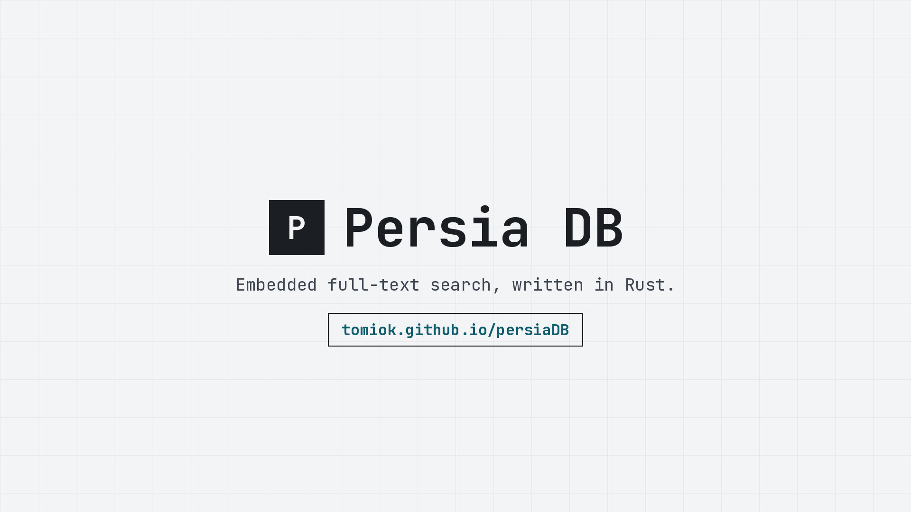
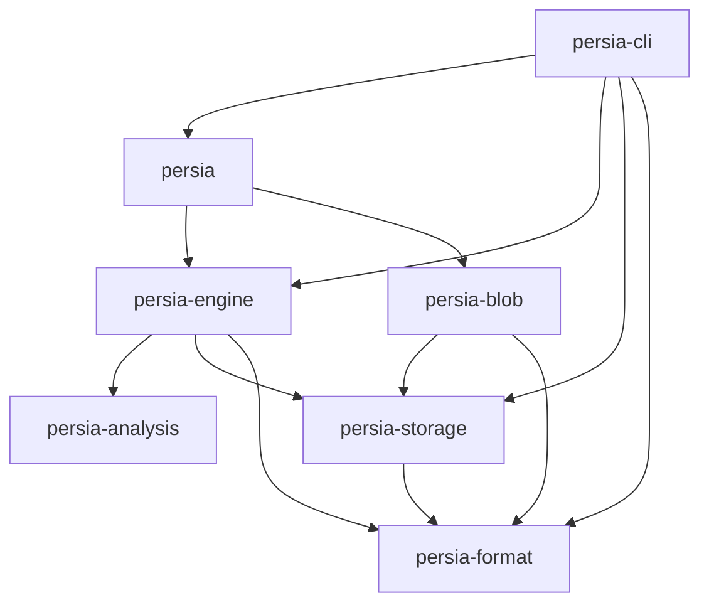

<p align="center">
  
</p>

<h1 align="center">Persia DB</h1>

<p align="center">
  <strong>An embedded, single-file search database, written in Rust.</strong><br>
  Open a file. Index documents. Ranked results, with relaxation on by default.
</p>

<p align="center">
  <a href="https://github.com/tomiok/persiaDB/actions/workflows/ci.yml"></a>
  <a href="./LICENSE"></a>
  <a href="./rust-toolchain.toml"></a>
  <a href="https://tomiok.github.io/persiaDB/"></a>
</p>

<p align="center">
  <a href="https://tomiok.github.io/persiaDB/">Docs</a>
  &nbsp;·&nbsp;
  <a href="https://tomiok.github.io/persiaDB/guide/getting-started/">Getting started</a>
  &nbsp;·&nbsp;
  <a href="./SPEC.md">SPEC</a>
  &nbsp;·&nbsp;
  <a href="./ROADMAP.md">Roadmap</a>
  &nbsp;·&nbsp;
  <a href="./PROGRESS.md">Progress</a>
</p>

> **Pre-alpha.** The 2026-10-27 snapshot in [`PROGRESS.md`](./PROGRESS.md) is **210 of 451** MVP leaves (47%). Post-MVP work is 0 of 164 and sits outside that percentage. Format 1.0 is unstable until the v1.0 release ([SPEC §15](./SPEC.md#15-versioning-and-compatibility)). When this file and `PROGRESS.md` disagree, `PROGRESS.md` wins.
>
> The [docs homepage](https://tomiok.github.io/persiaDB/) plays this poster from [`persia-hero.webm`](./website/public/persia-hero.webm) and [`persia-hero.mp4`](./website/public/persia-hero.mp4).

`persia` does not export `Db` yet. What you can call today is the segment library, the text analyzers, the single-file container, and a small CLI. Query, ranking, and relaxation are specified and not implemented.

## Why Persia DB

The product is a search database you link, the way you link SQLite. The design is [SPEC §1](./SPEC.md#1-goals-and-non-goals). The rows below say what that buys, and how far the tree has gotten.

| | Benefit | Where it stands |
|---|---|---|
| **Embedded** | The calling process is the database. `Db::open("app.persia")` is the whole setup: no daemon, no config file, no cluster. | The facade is [M10](./ROADMAP.md). The container, analyzers, and segment read/write are libraries now. |
| **Rust, short dependency list** | The index format, analysis, and segment codec are written in this repository. BM25F and query execution are specified for the same crate ([ADR-0001](./docs/adr/0001-own-engine-and-allowed-dependencies.md), M7). | `cargo deny` rejects Tantivy, SQLite, and RocksDB. `cargo xtask check-deps` rejects any direct dependency outside the workspace allow-list. There is no `build.rs`. |
| **One file, then object storage** | A local database is `<name>.persia`, plus an optional `<name>.persia.blobs` pack. Segments are immutable. The same segment bytes are specified for S3, GCS, and Azure Blob, in front of stateless query nodes. | The container and the segment format exist. Cloud backends, the server, and Kubernetes are M11–M13. |
| **A page of results** | Relaxation is the default ([SPEC §7](./SPEC.md#7-search)). Too few hits, and the engine walks synonyms, dropped terms, prefix, a fuzzy step, and a fallback, then names the step that matched. | Specified. Milestone M8. |

Out of scope for v1, in the SPEC: SQL, joins, vector search, more than one writer on a shard, and encryption inside the file. Encryption at rest is v1.2. Geo and the enterprise work are v3.0. See [Status](#status).

## Comparison

Product shape, from [SPEC §1](./SPEC.md#1-goals-and-non-goals), the [comparison guide](https://tomiok.github.io/persiaDB/guide/comparison/), and each project's own documentation.

| | Persia DB | Elasticsearch | Meilisearch / Typesense | Tantivy | SQLite FTS5 |
|---|---|---|---|---|---|
| What it is | Embedded full-text search database in Rust. A server mode is planned. | Distributed search server on Lucene. | Search servers with an HTTP API. Meilisearch is Rust. Typesense is C++. | Full-text search library in Rust. Its own line is Lucene, in Rust. | Full-text module inside SQLite, a C library. |
| How you run it | Planned: in-process, `Db::open` on a file. | A cluster. Clients use HTTP. | A separate process. Clients use HTTP. | In-process. You own the index directory and the serving code. | In-process. SQL `MATCH` on the SQLite file. |
| What you store | Planned: one `<name>.persia` file and an optional blob pack. Segment bytes are specified to be identical in object storage. | The cluster's data path. | The server's data directory. | A directory of segment files. | The FTS5 index lives in the SQLite database file. |
| A mistyped query | Planned default: a named relaxation cascade (SPEC §7). | Analyzers, fuzziness, and suggesters, configured on the query. | Typo tolerance is part of both products. | You compose the query. | `MATCH` returns the rows that match. `bm25()` ranks them. |
| Today | Pre-alpha. Codecs, local storage, schema, analysis, segment read/write, and a small CLI. | A released server. | Released servers. | A released library. | Part of SQLite. |

For a search feature in production today, use one of the released tools. Persia DB is the design in the SPEC — an embedded Rust API, one local file, the same segment bytes in object storage, relaxation on by default — and the implementation of the layers under that API.

## Quickstart

The crates are unpublished (`publish = false`, version `0.0.0`). There is no crates.io release and no `cargo add persia`.

### Build a segment and look up a term

This is the highest API the engine exports. It writes one immutable segment in memory and reads it back. Opening `app.persia`, ranking, and relaxation are the [planned API](#planned-embedded-api) below. The calls are the doctest on [`Segment`](./crates/persia-engine/src/segment/read.rs), wrapped in `main`.

```toml
[dependencies]
persia-engine = { git = "https://github.com/tomiok/persiaDB" }
persia-analysis = { git = "https://github.com/tomiok/persiaDB" }
persia-format = { git = "https://github.com/tomiok/persiaDB" }
```

```rust
use persia_analysis::AnalyzerRegistry;
use persia_engine::document::{Document, Value};
use persia_engine::schema::{FieldKind, SchemaBuilder, TextOptions};
use persia_engine::segment::{Segment, SegmentBuilder, SegmentMeta, SegmentWriter};
use persia_format::ByteSource;

fn main() -> Result<(), Box<dyn std::error::Error>> {
    let schema = SchemaBuilder::new("notes")
        .field("body", FieldKind::Text(TextOptions::default()))
        .build()?;
    let body = schema.field("body").map(|f| f.id()).ok_or("no field")?;
    let mut builder = SegmentBuilder::new(&schema, &AnalyzerRegistry::builtin())?;
    builder.add(&Document::new("n1").with(body, Value::String("Hello, world".into())))?;

    let meta = SegmentMeta {
        segment_id: 7,
        created_at: 0,
        merge_generation: 0,
    };
    let bytes = SegmentWriter::new(&builder, meta).finish()?;

    // The default text analyzer is `standard`: "Hello" is indexed as "hello".
    let segment = Segment::open(ByteSource::new(bytes.into()), &schema)?;
    assert_eq!((segment.segment_id(), segment.doc_count()), (7, 1));
    let info = segment.terms(body)?.get(b"hello")?.ok_or("no term")?;
    assert_eq!(info.df(), 1);
    assert_eq!(
        segment.document(0)?.get(body),
        Some(&Value::String("Hello, world".into()))
    );
    Ok(())
}
```

Field types on a [`CollectionSchema`](./crates/persia-engine/src/schema.rs) are `text`, `keyword`, `i64`, `f64`, `bool`, `datetime`, and `stored`. A schema is valid only after `SchemaBuilder::build` or `CollectionSchema::from_json`.

`Container::create("app.persia")` and `Container::open` in [`persia-storage`](./crates/persia-storage/src/container/path.rs) create and recover the single-file container (header, two superblock slots, checksummed frames). That file is the container. It is not yet an index of documents.

### CLI

```bash
git clone https://github.com/tomiok/persiaDB.git
cd persiaDB
cargo run -p persia-cli -- inspect segment \
  tests/fixtures/segment/v1.0/basic.pseg \
  --schema tests/fixtures/segment/v1.0/basic.schema.json \
  --verify
```

The binary is `persia`. These subcommands exist:

| Command | What it does |
|---|---|
| `persia inspect segment <file> --schema <json> [--verify]` | Footer, sections, per-field statistics. `--verify` checks every CRC and fails on a corrupt segment. |
| `persia dump segment <file> --schema <json> --field <name> [--term <term>]` | Terms of a `text` or `keyword` field, or one term's postings. The term is the indexed form. |
| `persia container files <file>` | Temporary and quarantine files next to a container. |
| `persia container sweep <file> [--quarantine]` | Removes stale temporary files. `--quarantine` also removes quarantine copies that existed before the command. |
| `persia store files <dir>` | Temporary files under a local object store. |
| `persia store sweep <dir> [--force]` | Removes temporary files a live writer does not hold. |

The golden segment above is format 1.0 and holds 300 documents (`doc_count` in the inspect output; see [`crates/persia-cli/tests/segment.rs`](./crates/persia-cli/tests/segment.rs)).

**Planned** (ROADMAP 10.4): `compact`, `stats`, `import` (JSONL), `search`, and `bench`.

### Planned embedded API

**Planned (M10).** This block does not compile. The names follow SPEC §6.2, §7, and §8.1. They are not a stable signature. The first release aimed at this shape is `v0.1` (M10), which waits on the write path, query, relaxation, and blobs. `v1.0` is the format freeze (M15).

```rust
// Planned. Not exported by the persia crate.
let db = persia::Db::open("app.persia")?;
let products = db.create_collection(schema)?;
products.put(doc)?;
products.commit()?;

// A typo still returns hits. The response names the change (SPEC §7).
let results = products.search("runing")?;
```

Go and TypeScript will call that same Rust core in-process. See [SDKs](#sdks).

## Format

The on-disk layout is a versioned format of this repository, specified in [`SPEC.md`](./SPEC.md) (draft v0.1). Anything written is little-endian and covered by a checksum. A layout change updates the SPEC, bumps a version or a feature flag, adds an ADR under [`docs/adr/`](./docs/adr/), and adds a golden fixture. Segments are immutable once written.

| Piece | Where | What it is |
|---|---|---|
| Container | [`header.rs`](./crates/persia-format/src/header.rs), SPEC §4 | Magic `PERSIA\0\x01`, format **1.0**, a 4096-byte header, two superblock slots, then frames. `format_major` 1 is the only major this build reads. |
| Segment | [`segment/write.rs`](./crates/persia-engine/src/segment/write.rs), SPEC §5 | Footer magic `PSEG`, format **1.0**. Sections, then the footer. `SegmentWriter` produces the bytes; `Segment::open` checks them. |
| CRC32C | [`checksum.rs`](./crates/persia-format/src/checksum.rs) | Castagnoli CRC on headers, frames, and blocks. A mismatch is `Error::Corrupt`, with the offset of the stored checksum. |
| zstd | [`compress.rs`](./crates/persia-format/src/compress.rs), [ADR-0005](./docs/adr/0005-block-compression-codecs.md) | Block codec `Zstd` or `None`. Decode requires the uncompressed length the block header declared, and returns `Error::Corrupt` for any other length. |
| XXH3 | [`hash.rs`](./crates/persia-format/src/hash.rs) | XXH3-64 and XXH3-128, default secret, seed 0, for content and routing hashes. Integrity is CRC32C. Blob ids are SHA-256 ([ADR-0002](./docs/adr/0002-blob-hash-sha256.md)). |
| mmap | [`mmap.rs`](./crates/persia-format/src/mmap.rs), [ADR-0010](./docs/adr/0010-mmap-unsafe-boundary-and-sigbus.md) | Read-only mapping of an immutable file range. A fault on a mapped page ends the process. Callers that cannot accept that use positioned reads. |
| `ByteSource` | [`source.rs`](./crates/persia-format/src/source.rs) | One buffer type for mapped, heap, and cached bytes. Clone and `slice` share the underlying `bytes::Bytes` (or the mapping) without copying the payload. |
| Unicode | [`persia-analysis`](./crates/persia-analysis/src/lib.rs), SPEC §6.3 | UAX #29 word boundaries and NFKC, pinned to Unicode **17.0.0**. Built-in analyzers: `standard`, `keyword`, `whitespace`, `en`, `es`, `pt`, `fr`, `de`, `it`. Stemmers for German, English, Spanish, French, Italian, and Portuguese. |
| Fuzzing | [`fuzz/fuzz_targets`](./fuzz/fuzz_targets), [`.github/workflows/fuzz.yml`](./.github/workflows/fuzz.yml) | cargo-fuzz on every target. Pull requests lint the fuzz crate. The scheduled workflow runs the targets on a dated nightly. |
| CI | [`.github/workflows/ci.yml`](./.github/workflows/ci.yml) | `rustfmt`, clippy `-D warnings` on the workspace and the fuzz crate, `cargo test --workspace` on Linux and macOS, format and storage tests on Windows, Miri on `persia-format`, `cargo deny` (bans, licenses, sources), dependency direction, golden fixtures, and a fresh `PROGRESS.md`. Advisories run daily. |

`unsafe` is confined to modules an ADR names: the mmap reader ([ADR-0010](./docs/adr/0010-mmap-unsafe-boundary-and-sigbus.md)), mapped container reads ([ADR-0017](./docs/adr/0017-mapped-container-reads.md)), and the OS calls `std` lacks ([ADR-0021](./docs/adr/0021-os-calls-for-file-system-type-and-identity.md)). Each `unsafe` block carries a `// SAFETY:` comment. Corrupt input is `Err`. The segment reader turns a bad segment into `ReadError`.

Term dictionaries are FSTs (`fst` pinned to 0.4.7, because the engine re-checks that parser). Column presence and postings deletions use Roaring bitmaps.

## Architecture

Arrows point from a crate to the crates it is allowed to depend on (`ALLOWED` in [`xtask/src/check_deps.rs`](./xtask/src/check_deps.rs)). The fuller map, including the write and query paths the SPEC describes, is [`docs/architecture.md`](./docs/architecture.md).



| Crate | Owns | In this tree |
|---|---|---|
| `persia-format` | Encodings, frames, header, superblock, checksums, compression, mmap. No I/O policy. | Implemented. |
| `persia-storage` | `Storage`, memory, local files, the single-file container, crash-test faults. | Implemented. S3, GCS, and Azure Blob are M12. |
| `persia-analysis` | Tokenizers, normalizers, stemmers, the analyzer registry. No internal dependencies. | Implemented. |
| `persia-engine` | Schema, documents, the manifest codec, segment build / write / read. Synchronous. I/O only through `Storage`. | Those pieces. Memtable, WAL, commit, merge, query, BM25F, and relaxation are M6–M8. |
| `persia-cli` | The `persia` binary. | Inspect, dump, and file sweep. See [CLI](#cli). |
| `persia` | The embedded facade: `Db`, `Collection`. | The dependency edges. No types yet. M10. |
| `persia-blob` | Content-addressed chunks, dedup, GC. | The dependency edges. M9, which can start. |
| `persia-proto`, `persia-server` | gRPC and HTTP. The server depends on `persia` and `persia-proto`. | Stubs. M11. |

`persia-server` is drawn in [`docs/architecture.md`](./docs/architecture.md) above `persia`. It is an empty `main` today, so it stays out of the figure.

## Status

MVP (M0–M15) is the v1.0 release. The live graph, the burn-up, and the ready-next list are [`PROGRESS.md`](./PROGRESS.md). The checklist is [`ROADMAP.md`](./ROADMAP.md). The same snapshot is on the [roadmap page](https://tomiok.github.io/persiaDB/roadmap/).

| Milestone | State in the 2026-10-27 snapshot |
|---|---|
| M0 Repository, M1 Format, M2 Storage, M3 Schema, M4 Analysis | Done. |
| M5 Segment writer and reader | 41 of 47 leaves. No leaf is marked in progress. |
| M9 Blob store | Ready to start. 0 of 20. |
| M6 Durability, M7 Query, M8 Relaxation, M10 Embedded API | Not started. M10 is the `Db` facade. |
| M11 Server, M12 Cloud storage, M13 Kubernetes, M14 Network SDKs, M15 v1.0 | Not started. Blocked on earlier milestones. |

### After v1.0

From the table under [After v1.0](./ROADMAP.md) on `main`. None of these leaves are started (0 of 164).

| Target | Milestones |
|---|---|
| v1.0 | M0–M15, the MVP |
| v1.1 | M16 Embedded SDKs, M17 Highlighting and snippets, M18 Autocomplete, M19 Import, M31 Persia Studio |
| v1.2 | M20 Encryption at rest, M21 Python SDK |
| v2.0 | M22 Multi-tenant, M23 Persia Cloud, M24 CDC connectors, M25 Web dashboard |
| v2.1 | M26 UI components |
| v2.2 | M27 AI search |
| v2.3 | M28 On-device |
| v3.0 | M29 Geo, M30 Enterprise |

v2.1, v2.2, and v2.3 are separate targets: UI components, AI search, and on-device storage. Geo stays on v3.0 with the enterprise format work. The ordering notes are in that ROADMAP section.

## SDKs

Rust is the native API. The facade crate is [`persia`](./crates/persia/src/lib.rs). The libraries under it are what a Rust caller can use today, as in the [quickstart](#build-a-segment-and-look-up-a-term).

Go and TypeScript embedded bindings are planned for **v1.1** (M16). The design is [ADR-0018](./docs/adr/0018-embedded-sdk-bindings.md) and [`docs/sdk/`](./docs/sdk/README.md), and it is not implemented. One C ABI (`persia-ffi`) wraps `persia`. Go calls it through cgo (`sdk/persia`). TypeScript calls it through N-API (`@persiadb/node`) for Node.js, Bun, and Deno. Ranking, relaxation, and crash recovery stay in the Rust core.

Two other clients are a different product, also unstarted: network clients in Rust (`persia-client`) and Go (`persia-go`) speak gRPC to `persia-server` (SPEC §13, M14). A Python SDK is v1.2 (M21), after the embedded bindings.

## Built with Claude Opus 5.5

This repository is built entirely with Claude Opus 5.5: the code, the tests, and the docs.

The engineering rules in [`CLAUDE.md`](./CLAUDE.md) bind those changes the same way they bind a human patch. [`SPEC.md`](./SPEC.md) is the contract. A byte string from disk, the network, or a user that fails a check comes back as `Err`. A change to the on-disk layout updates the SPEC, bumps a version or a feature flag, adds an ADR, and adds a golden fixture.

## Contributing

1. Read [`SPEC.md`](./SPEC.md) and [`CLAUDE.md`](./CLAUDE.md).
2. Pick one leaf in [`ROADMAP.md`](./ROADMAP.md). [`PROGRESS.md`](./PROGRESS.md) lists what is ready next. One leaf, one pull request.
3. If the SPEC is unclear, open an issue before the code. The code and the SPEC stay in step.

```bash
git clone https://github.com/tomiok/persiaDB.git && cd persiaDB
cargo test --workspace
```

rustup installs the pinned toolchain from [`rust-toolchain.toml`](./rust-toolchain.toml) (Rust 1.99.0, which is also the MSRV until v1.0). Before a pull request: `cargo fmt --all -- --check`, `cargo clippy --workspace --all-targets --all-features -- -D warnings`, `cargo test --workspace`, `cargo xtask check-deps`, and `cargo xtask progress --check`. The long form is [`CONTRIBUTING.md`](./CONTRIBUTING.md).

By participating you agree to the [Code of Conduct](./CODE_OF_CONDUCT.md). Report security issues in private, as [`SECURITY.md`](./SECURITY.md) describes. Only the latest commit on `main` receives fixes. Treat a panic or unbounded memory use on a crafted database file as a security issue (SPEC §17).

Commit messages follow [Conventional Commits](https://www.conventionalcommits.org/): `feat(engine): ...`, `fix(format): ...`, `docs: ...`.

## License

[Apache License 2.0](./LICENSE). The license guide on the docs site is [here](https://tomiok.github.io/persiaDB/guide/license/).

## Documentation

| | |
|---|---|
| [persiadb docs](https://tomiok.github.io/persiaDB/) | Guides, status, the intended API |
| [Getting started](https://tomiok.github.io/persiaDB/guide/getting-started/) | What you can call, and the API that is still a sketch |
| [Embedded search](https://tomiok.github.io/persiaDB/guide/embedded-search/) | In-process search, one file, no server |
| [Comparison](https://tomiok.github.io/persiaDB/guide/comparison/) | SQLite FTS5, Tantivy, Meilisearch, Lucene, Elasticsearch |
| [FAQ](https://tomiok.github.io/persiaDB/guide/faq/) | Status, format, crash safety, SDKs, license |
| [SDKs](https://tomiok.github.io/persiaDB/guide/sdks/) | The Go and TypeScript design |
| [How it works](https://tomiok.github.io/persiaDB/architecture/) | Segments, frames, the paths in the SPEC |
| [llms.txt](https://tomiok.github.io/persiaDB/llms.txt) | Every docs page, for agents. [llms-full.txt](https://tomiok.github.io/persiaDB/llms-full.txt) is those pages in Markdown |
| [`SPEC.md`](./SPEC.md) | The design contract |
| [`docs/architecture.md`](./docs/architecture.md) | Crate map for contributors |
| [`docs/adr/`](./docs/adr/) | Architecture decision records |
