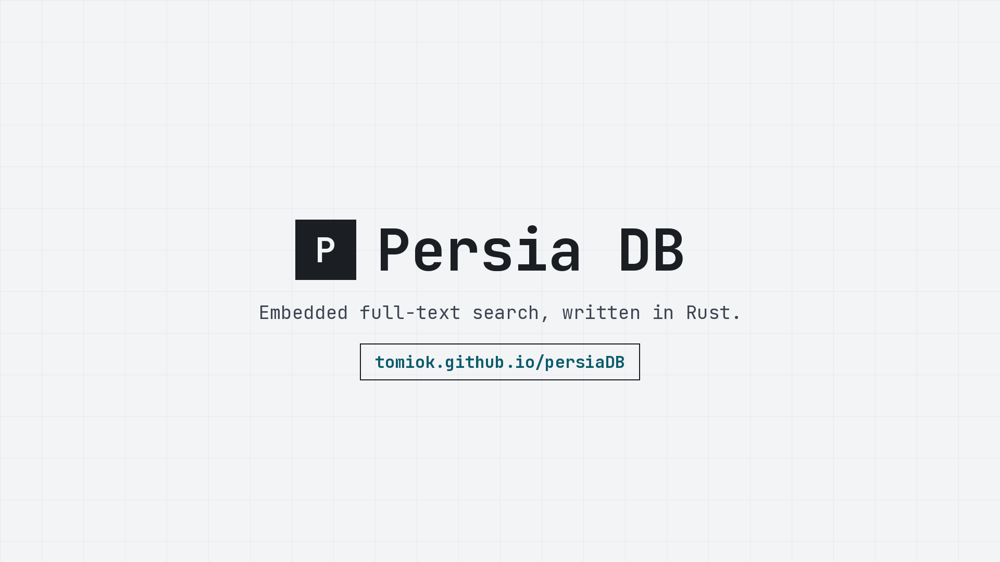
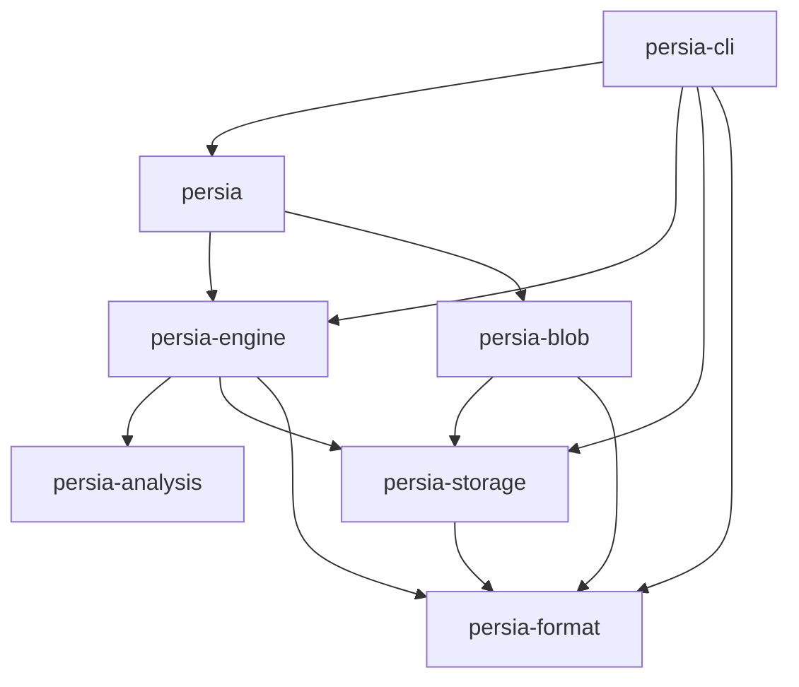

<p align="center">
  
</p>

<h1 align="center">Persia DB</h1>

<p align="center">
  <strong>An embedded, single-file search database, written in Rust.</strong><br>
  Open a file. Index documents. Get ranked results.<br>
  A search that would come back empty relaxes instead, and the response names the step that matched.
</p>

<p align="center">
  <a href="https://github.com/tomiok/persiaDB/actions/workflows/ci.yml"></a>
  <a href="./LICENSE"></a>
  <a href="./rust-toolchain.toml"></a>
  <a href="https://tomiok.github.io/persiaDB/"></a>
</p>

<p align="center">
  <a href="https://tomiok.github.io/persiaDB/">Docs</a>
  &nbsp;·&nbsp;
  <a href="https://tomiok.github.io/persiaDB/guide/getting-started/">Getting started</a>
  &nbsp;·&nbsp;
  <a href="./SPEC.md">SPEC</a>
  &nbsp;·&nbsp;
  <a href="./ROADMAP.md">Roadmap</a>
  &nbsp;·&nbsp;
  <a href="./PROGRESS.md">Progress</a>
</p>

<!-- BEGIN GENERATED progress:summary by `cargo xtask progress`. Do not edit by hand. -->
**Pre-alpha.** [`PROGRESS.md`](./PROGRESS.md) counts **464 of 618** MVP leaves done (75%), 0 in progress (last snapshot 2026-11-27). Post-MVP work is 0 of 228 and sits outside that percentage.
<!-- END GENERATED progress:summary -->

On `main` today, the [`persia`](./crates/persia/src/lib.rs) crate opens a single-file database, stores documents and blobs, and runs a ranked search (BM25F, filters, sorts, facets, cursors) that relaxes by default when a query finds too few hits. Writes go through a checksummed WAL with crash recovery, and commits, merges, and compaction run on the database's own thread. Nothing is published yet, and format 1.0 is unstable until the v1.0 release ([SPEC §15](./SPEC.md#15-versioning-and-compatibility)); the internals are in [`SPEC.md`](./SPEC.md).

## Why Persia DB

The product is a search database you link, the way you link SQLite. The design is [SPEC §1](./SPEC.md#1-goals-and-non-goals). The rows below say what that buys, and how far the tree has gotten.

| | Benefit | Where it stands |
|---|---|---|
| **Embedded** | The calling process is the database. `Db::open("app.persia")` is the whole setup: no daemon, no config file, no cluster. | Works: `persia::Db`, `OpenOptions`, and `Collection`. The cargo feature `async` adds `AsyncDb` and `AsyncCollection`, which need no runtime. The rest of the async surface and API polish are still in M10. |
| **Rust, short dependency list** | The index format, analysis, segment codec, BM25F scoring, and query execution are written in this repository ([ADR-0001](./docs/adr/0001-own-engine-and-allowed-dependencies.md)). | `cargo deny` rejects Tantivy, SQLite, and RocksDB. `cargo xtask check-deps` rejects any direct dependency outside the workspace allow-list. There is no `build.rs`. |
| **One file, then object storage** | A local database is `<name>.persia`, plus an optional `<name>.persia.blobs` pack. Segments are immutable. The same segment bytes are specified for S3, GCS, and Azure Blob, in front of stateless query nodes. | Works locally: the container, segments, the blob pack, and `Db::backup` of a live database. Object-storage backends (M12), the server (M11), and Kubernetes (M13) are planned; `Db::open("s3://…")` returns `Unsupported` today. |
| **A page of results** | Relaxation is the default ([SPEC §7.6](./SPEC.md#76-zero-results-avoidance-default-on)). Too few hits, and the engine walks synonyms, dropped terms, prefix, a fuzzy step, and a fallback, then names the step that matched. | Works: `Collection::search` relaxes by default, reports the level and any "did you mean" corrections in `SearchResponse::relaxation`, and takes per-request `relax` options (`"relax": false` turns it off). |

Out of scope for v1, in the SPEC: SQL, joins, vector search, more than one writer on a shard, and encryption inside the file. Encryption at rest is v1.2. Geo and the enterprise work are v3.0. See [Status](#status).

## Quickstart

The crates are unpublished (`publish = false`, version `0.0.0`). There is no crates.io release and no `cargo add persia`; depend on the Git repository.

```toml
[dependencies]
persia = { git = "https://github.com/tomiok/persiaDB" }
```

```rust
use persia::{Db, SearchRequest};

fn main() -> persia::Result<()> {
    let db = Db::open("app.persia")?; // creates app.persia if it is missing
    let notes = db.create_collection_json(
        r#"{"name": "notes", "fields": {"body": {"type": "text"}}}"#,
    )?;
    notes.put_json(r#"{"id": "n1", "body": "Hello, world"}"#)?;
    notes.put_json(r#"{"id": "n2", "body": "hello, hello again"}"#)?;
    notes.put_json(r#"{"id": "n3", "body": "goodbye"}"#)?;
    notes.commit()?;

    // Ranked with BM25F: "n2" says hello twice, so it ranks first. "goodbye" does not match.
    let page = notes.search(&SearchRequest::new("hello"))?;
    let ids: Vec<_> = page.hits.iter().map(|h| h.document.id()).collect();
    assert_eq!(ids, ["n2", "n1"]);

    // A typo still returns hits, and the response says how the query was relaxed.
    let page = notes.search(&SearchRequest::new("helo"))?;
    assert!(!page.hits.is_empty());
    println!("{:?} {:?}", page.relaxation.level, page.relaxation.corrected());
    // Fuzzy [Correction { original: "helo", corrected: "hello" }]

    db.close()
}
```

`Db::open` creates the file and any missing parent directories, and opens an existing database without replacing it ([SPEC §8.1](./SPEC.md#81-operations)). A second run fails at `create_collection_json` with `ErrorCode::AlreadyExists`, so use `db.collection("notes")` or delete `app.persia` first. Commits and merges also run on the database's own thread; `close` joins it ([SPEC §8.2](./SPEC.md#82-flow)).

Beyond the snippet:

- **Schemas**: `create_collection` takes a `SchemaBuilder` schema. Field types are `text`, `keyword`, `i64`, `f64`, `bool`, `datetime`, and `stored`.
- **Documents**: `put` (a `Document`), `put_batch`, `put_json`, `put_struct` (any `serde` type), `get`, `get_json`, `get_struct`, and `delete`.
- **Search**: `SearchRequest` builders for `fields`, `filter`, `soft_filter`, `sort`, `limit`, `offset`, `after` (a cursor), `facets`, `explain`, and `relax`; or the request JSON with `search_json`.
- **Blobs**: `Db::put_blob`, `Db::get_blob`, `Db::get_blob_range`, and `Collection::put_with_blob`, stored in the `<name>.persia.blobs` pack.
- **Options**: `OpenOptions` (`read_only`, `create_if_missing`, `durability`, `memtable_bytes`, `block_cache_bytes`, ...). Every error carries a stable `ErrorCode`.

The API reference is `cargo doc -p persia --open`. Go and TypeScript will call the same Rust core in-process; see [SDKs](#sdks).

## Comparison

Product shape, from [SPEC §1](./SPEC.md#1-goals-and-non-goals), the [comparison guide](https://tomiok.github.io/persiaDB/guide/comparison/), and each project's own documentation.

| | Persia DB | Elasticsearch | Meilisearch / Typesense | Tantivy | SQLite FTS5 |
|---|---|---|---|---|---|
| What it is | Embedded full-text search database in Rust. A server mode is planned. | Distributed search server on Lucene. | Search servers with an HTTP API. Meilisearch is Rust. Typesense is C++. | Full-text search library in Rust. Its own line is Lucene, in Rust. | Full-text module inside SQLite, a C library. |
| How you run it | In-process: `Db::open` on a file. | A cluster. Clients use HTTP. | A separate process. Clients use HTTP. | In-process. You own the index directory and the serving code. | In-process. SQL `MATCH` on the SQLite file. |
| What you store | One `<name>.persia` file and an optional blob pack. Object storage is planned, with the same segment bytes. | The cluster's data path. | The server's data directory. | A directory of segment files. | The FTS5 index lives in the SQLite database file. |
| A mistyped query | Relaxed by default: a named cascade with "did you mean" corrections ([SPEC §7.6](./SPEC.md#76-zero-results-avoidance-default-on)). | Analyzers, fuzziness, and suggesters, configured on the query. | Typo tolerance is part of both products. | You compose the query. | `MATCH` returns the rows that match. `bm25()` ranks them. |
| Today | Pre-alpha, unreleased. The embedded API, engine, relaxation, blob store, and CLI work on `main`. Server, cloud storage, distribution, and SDKs are planned. | A released server. | Released servers. | A released library. | Part of SQLite. |

For a search feature in production today, use one of the released tools. Persia DB has no release yet, and its on-disk format can still change before v1.0.

## CLI

The binary is `persia`, in [`persia-cli`](./crates/persia-cli/src/main.rs).

```bash
git clone https://github.com/tomiok/persiaDB.git
cd persiaDB
cargo run -p persia-cli -- inspect segment \
  tests/fixtures/segment/v1.0/basic.pseg \
  --schema tests/fixtures/segment/v1.0/basic.schema.json \
  --verify
cargo run -p persia-cli -- stats path/to/app.persia
```

| Command | What it does |
|---|---|
| `persia stats <file> [--json]` | What a read-only open reports, without the writer lock: the last commit, the container's live and dead space, the WAL after the last commit, the blob pack's size, and each collection's schema, documents and segments. |
| `persia verify <file> [--quick \| --deep]` | Checks a whole database read-only: every check an open makes, every segment's bytes, one live copy per document id, then every referenced blob in the pack. `--quick` skips the pack's checksum scan; `--deep` also re-hashes every referenced blob. |
| `persia compact <file> [--json]` | Rewrites the container without its dead frames and prints the space before and after. Opens read-write, so it fails while another writer has the database. Commits no document of its own, but its open recovers as any writer's does (a WAL backlog over the default 64 MiB memtable is flushed). Leaves the blob pack alone. Has the built-in analyzers only, yet compacts a database whose schema names a registered one: that field is not analyzed and its WAL records stay in the WAL; it fails (status 1) only when its recovery would flush any collection while such a collection holds a replayed WAL record (a replay flushes a memtable at the default 64 MiB, measured on the stand-in for such a collection, or out of docids): open the database with its application and commit (e.g. `Db::close`; a reopen alone may flush nothing), then compact. |
| `persia gc <file> [--grace <dur>] [--json]` | Blob garbage collection (SPEC §9.5): marks every blob a document or WAL record references, deletes the others and their staged chunks, and rewrites the pack when at least half its frame bytes are dead. Opens read-write, so it fails while another writer has the database. Built-in analyzers only, yet it collects a database whose schema names a registered analyzer (ROADMAP 10.4.7), unless its recovery would have to flush that collection (status 1: open the database with its application and commit first). Reports what it deleted and kept, the pack's size before and after, and the reader leases: a read-only handle of another process that has not refreshed since the last commit holds the sweep back (nothing deleted, said in the report). `--grace` (`<n>s/m/h/d`, default `24h`, at least `2h`) ages a remote store's objects; the local pack keeps no ages and drops what is unmarked at once. A database without a pack is a no-op (only the pack's writer lock file appears). |
| `persia import <file> --collection <name> [--input <jsonl>] [--schema <json>] [--json]` | Reads JSON Lines (a file, or the standard input) into a collection, one document per line in the form `dump documents` writes; commits at least at the end. Opens read-write. `--schema` creates the database and the collection when missing. The first bad line (not UTF-8, over 16 MiB, not JSON, not a document of the schema, or a blob reference this database's blob store does not hold) stops the import with status 1 (3 when the put reaches stored damage, the embedded API's `ErrorCode::Corrupt`; a `BlobRef` naming a stored blob with another `size` or `chunk_size` is a bad line, status 1), naming the line: the lines before it are imported and committed, nothing from it on. A dump carries blob references, not blob bytes, so a dump with blobs imports only into its own database (ROADMAP 10.4.6). |
| `persia search <file> --collection <name> (--query <text> \| --request <json>) [--json]` | One search, by user text with every default (relaxed, 20 hits) or by request JSON. Read-only, without the writer lock. Prints each hit's rank, score and document; `--json` writes the response JSON of SPEC §7.5.2. |
| `persia dump documents <file> --collection <name>` | The collection's live documents as JSON Lines (the `get` form of a document), in storage order. |
| `persia inspect container <file> [--id <id>]` | The active superblock and every frame recovery reads; with `--id`, the WAL records that put or delete that document id. |
| `persia inspect segment <file> --schema <json> [--verify]` | Footer, sections, per-field statistics. `--verify` checks every CRC and fails on a corrupt segment. |
| `persia dump segment <file> --schema <json> --field <name> [--term <term>]` | Terms of a `text` or `keyword` field, or one term's postings. The term is the indexed form. |
| `persia container files <file>` | Temporary and quarantine files next to a container. |
| `persia container sweep <file> [--quarantine]` | Removes stale temporary files. `--quarantine` also removes quarantine copies that existed before the command. |
| `persia store files <dir>` | Temporary files under a local object store. |
| `persia store sweep <dir> [--force]` | Removes temporary files a live writer does not hold. |
| `persia bench [--dir <dir>] [--docs <n>] [--queries <n>] [--seed <n>] [--json]` | A quick local micro-benchmark on a seeded synthetic corpus in a scratch directory it removes. Its numbers are local guidance only, not a published benchmark. |

Every command exits with status 0 on success, 1 on any other failure, 2 on a usage error, 3 on corrupt Persia data (or, for `verify`, a missing referenced blob), and 4 when the file is not a Persia container. The `persia-cli` crate docs ([`main.rs`](./crates/persia-cli/src/main.rs)) hold the table of each command's status by what it finds at the path.

**`--json` output.** One JSON object on one line. These are its keys; keys are only ever added. Byte counts are bytes, times are nanoseconds.

- `persia stats --json`:
  - `path` (canonical), `format` `{major, minor}`, `db_uuid` (32 hex digits), `seq` (the last commit's);
  - `container` `{bytes, live_bytes, dead_bytes, compaction_due, uncommitted_frames, uncommitted_bytes}`: `bytes` is the end of the valid frames, `compaction_due` whether a writer with the default thresholds (40% and 1 MiB dead) would compact, since an application's own `CompactionOptions` are not stored in the file, the `uncommitted_*` the valid frames after the last commit;
  - `wal` `{wal_start, log_end, replayed_records, frames_after_commit, bytes_after_commit}`;
  - `collections`, by name: `{name, schema: {hash, strict, fields: [{name, type}]}, documents, segment_documents, deleted, wal_documents, segment_bytes, segments: [{id, documents, deleted, bytes}]}`; `documents` counts the live documents a reader sees;
  - `blob_pack` `{present, bytes}`, `bytes` `null` without a pack.
- `persia compact --json`: `seq` (the compacted file's), `before` and `after` `{bytes, live_bytes, dead_bytes}`, `reclaimed_bytes`.
- `persia gc --json`:
  - `grace_secs`, `held_back` (the sweep did not run: a reader lease or a backup in progress), `held_by_copy`;
  - `pack` `{present, bytes_before, bytes_after}` (the pack file's size around the command, `null` without one; `bytes_after` is also `null` when the size could not be read after a GC that succeeded, said on stderr), `marked` `{blobs, uploads}`, `missing` (hex ids of referenced blobs the pack lacks: dangling references, which `verify` fails on);
  - `deleted` `{blobs, uploads, chunks}`, `kept` `{pinned, young, unknown_age, changed, unreadable, uploads_skipped}` (unmarked objects the sweep kept, and whether it left the staged chunks alone; `young` is always 0 for the local pack);
  - `rewrite` `{outcome, dead_bytes, frame_bytes, generation, frame_bytes_before, frame_bytes_after}`, `outcome` one of `no_pack`, `below_ratio`, `deferred`, `done`, `not_run`, the other keys `null` where the outcome has none;
  - `readers`, `null` without a pack, else `{live, current, opening, behind, ahead, unreadable, stale_removed, oldest_seq}` (the reader leases' states; their paths go to the GC's log, not the report).
- `persia import --json`: `collection`, `created` (whether `--schema` created the collection), `lines` (read), `blank_lines` (skipped), `documents` (put; a replaced id counts each time).
- `persia search --json`: the response JSON of SPEC §7.5.2 (`hits`, `facets`, `relaxation`, `query_truncated`), as the embedded API's `SearchResponse::to_json` writes it.
- `persia bench --json`:
  - `notice` (the numbers are local guidance only), `build` (`release` or `debug`), `seed`, `docs`, `queries`;
  - `corpus` `{fingerprint, container_bytes}`, `indexing` `{nanos, docs_per_second, commit_nanos}` (`docs_per_second` `null` when the clock read no time), `query_mix` `{fingerprint}` (fingerprints are 16 hex digits);
  - `query_kinds`, in rotation order (`term`, `terms`, `phrase`, `filter`, `typo`): `{kind, count, hits, empty, truncated, latency_nanos: {p50, p90, p99, max}}`. `latency_nanos` is `null` for a kind that ran no query; `empty` counts the queries that returned no hit. `truncated` counts the queries whose page the relaxation time budget (SPEC §7.6) cut short; `hits` repeat for a seed only where `truncated` is 0.

The golden segment above is format 1.0 and holds 300 documents (`doc_count` in the inspect output; see [`crates/persia-cli/tests/segment.rs`](./crates/persia-cli/tests/segment.rs)).

## Format

The on-disk layout is a versioned format of this repository, specified in [`SPEC.md`](./SPEC.md) (draft v0.1). Anything written is little-endian and covered by a checksum. A layout change updates the SPEC, bumps a version or a feature flag, adds an ADR under [`docs/adr/`](./docs/adr/), and adds a golden fixture. Segments are immutable once written.

| Piece | Where | What it is |
|---|---|---|
| Container | [`header.rs`](./crates/persia-format/src/header.rs), SPEC §4 | Magic `PERSIA\0\x01`, format **1.0**, a 4096-byte header, two superblock slots, then frames. `format_major` 1 is the only major this build reads. |
| Segment | [`segment/write.rs`](./crates/persia-engine/src/segment/write.rs), SPEC §5 | Footer magic `PSEG`, format **1.0**. Sections, then the footer. `SegmentWriter` produces the bytes; `Segment::open` checks them. |
| CRC32C | [`checksum.rs`](./crates/persia-format/src/checksum.rs) | Castagnoli CRC on headers, frames, and blocks. A mismatch is `Error::Corrupt`, with the offset of the stored checksum. |
| zstd | [`compress.rs`](./crates/persia-format/src/compress.rs), [ADR-0005](./docs/adr/0005-block-compression-codecs.md) | Block codec `Zstd` or `None`. Decode requires the uncompressed length the block header declared, and returns `Error::Corrupt` for any other length. |
| XXH3 | [`hash.rs`](./crates/persia-format/src/hash.rs) | XXH3-64 and XXH3-128, default secret, seed 0, for content and routing hashes. Integrity is CRC32C. Blob ids are SHA-256 ([ADR-0002](./docs/adr/0002-blob-hash-sha256.md)). |
| mmap | [`mmap.rs`](./crates/persia-format/src/mmap.rs), [ADR-0010](./docs/adr/0010-mmap-unsafe-boundary-and-sigbus.md) | Read-only mapping of an immutable file range. A fault on a mapped page ends the process. Callers that cannot accept that use positioned reads. |
| `ByteSource` | [`source.rs`](./crates/persia-format/src/source.rs) | One buffer type for mapped, heap, and cached bytes. Clone and `slice` share the underlying `bytes::Bytes` (or the mapping) without copying the payload. |
| Unicode | [`persia-analysis`](./crates/persia-analysis/src/lib.rs), SPEC §6.3 | UAX #29 word boundaries and NFKC, pinned to Unicode **17.0.0**. Built-in analyzers: `standard`, `keyword`, `whitespace`, `en`, `es`, `pt`, `fr`, `de`, `it`. Stemmers for German, English, Spanish, French, Italian, and Portuguese. |
| Fuzzing | [`fuzz/fuzz_targets`](./fuzz/fuzz_targets), [`.github/workflows/fuzz.yml`](./.github/workflows/fuzz.yml) | cargo-fuzz on every target. Pull requests lint the fuzz crate. The scheduled workflow runs the targets on a dated nightly. |
| CI | [`.github/workflows/ci.yml`](./.github/workflows/ci.yml) | `rustfmt`, clippy `-D warnings` on the workspace and the fuzz crate, `cargo test --workspace` on Linux and macOS, format and storage tests on Windows, Miri on `persia-format` and the pure parsers of `persia-engine`, `cargo deny` (bans, licenses, sources), dependency direction, golden fixtures, and a fresh `PROGRESS.md`. Advisories run daily. |

`unsafe` is confined to modules an ADR names: the mmap reader ([ADR-0010](./docs/adr/0010-mmap-unsafe-boundary-and-sigbus.md)), mapped container reads ([ADR-0017](./docs/adr/0017-mapped-container-reads.md)), and the OS calls `std` lacks ([ADR-0021](./docs/adr/0021-os-calls-for-file-system-type-and-identity.md)). Each `unsafe` block carries a `// SAFETY:` comment. Corrupt input is `Err`. The segment reader turns a bad segment into `ReadError`.

Term dictionaries are FSTs (`fst` pinned to 0.4.7, because the engine re-checks that parser). Column presence and postings deletions use Roaring bitmaps.

## Architecture

Arrows point from a crate to the crates it is allowed to depend on (`ALLOWED` in [`xtask/src/check_deps.rs`](./xtask/src/check_deps.rs)). The fuller map, including the write and query paths the SPEC describes, is [`docs/architecture.md`](./docs/architecture.md).



| Crate | Owns | In this tree |
|---|---|---|
| `persia-format` | Encodings, frames, header, superblock, checksums, compression, mmap. No I/O policy. | Implemented. |
| `persia-storage` | `Storage`, memory, local files, the single-file container, crash-test faults. | Implemented. S3, GCS, and Azure Blob are planned (M12). |
| `persia-analysis` | Tokenizers, normalizers, stemmers, the analyzer registry. No internal dependencies. | Implemented. |
| `persia-engine` | Schema, documents, manifests, segments, memtable, WAL, commit, recovery, merges, compaction, query compilation, BM25F, search, and the relaxation cascade. Synchronous. I/O only through `Storage`. | Implemented (M6–M8). Not a stable API: applications use `persia`. |
| `persia-blob` | Content-addressed chunks, dedup, the blob pack, GC. | Implemented (M9). |
| `persia` | The embedded facade: `Db`, `Collection`. | Core implemented: open, collections, documents, search, blobs, `Db::backup`, and the optional `async` API. Still in M10: the rest of the async API, API polish, examples, and release engineering. |
| `persia-cli` | The `persia` binary. | Implemented: stats, verify, compact, gc, import, search, dump, inspect, file sweeps, and bench. See [CLI](#cli). |
| `persia-proto`, `persia-server` | gRPC and HTTP. The server depends on `persia` and `persia-proto`. | Placeholders for M11. The server binary exits with "not implemented". |

`persia-server` is drawn in [`docs/architecture.md`](./docs/architecture.md) above `persia`. Today it is a placeholder binary that prints "not implemented (M11)" and exits with status 1, so it stays out of the figure.

<details>
<summary>One layer down: the same search on <code>persia-engine</code> (not a stable API)</summary>

### Index documents and search them

`persia` is built on this. The block runs as the test [`readme_quickstart.rs`](./crates/persia-engine/tests/readme_quickstart.rs). `Database::create` refuses a file that exists, so delete `app.persia` before running it again.

```rust
use persia_analysis::AnalyzerRegistry;
use persia_engine::db::{Database, DatabaseOptions, SearchRequest};
use persia_engine::document::{Document, Value};
use persia_engine::query::{DefaultFields, QueryCompiler, QueryLimits};
use persia_engine::schema::{FieldKind, SchemaBuilder, TextOptions};
use persia_engine::search::{Pruning, SearchPlan};
use persia_engine::wal::Durability;

fn main() -> Result<(), Box<dyn std::error::Error>> {
    let schema = SchemaBuilder::new("notes")
        .field("body", FieldKind::Text(TextOptions::default()))
        .build()?;
    let body = schema.field("body").map(|f| f.id()).ok_or("no field")?;

    let mut db = Database::create("app.persia", DatabaseOptions::default())?;
    db.create_collection(schema)?;
    for (id, text) in [
        ("n1", "Hello, world"),
        ("n2", "hello, hello again"),
        ("n3", "goodbye"),
    ] {
        let doc = Document::new(id).with(body, Value::String(text.into()));
        db.put("notes", &doc, Durability::Fsync)?;
    }
    db.commit()?;

    // Compile user text, plan it against the collection's statistics, run it (BM25F, SPEC §7).
    let snapshot = db.snapshot();
    let notes = snapshot.collection("notes").ok_or("no collection")?;
    let compiler = QueryCompiler::new(notes.schema(), &AnalyzerRegistry::builtin())?;
    let query = compiler
        .compile(
            "hello",
            &DefaultFields::all(notes.schema()),
            &QueryLimits::default(),
        )
        .into_query();
    let memtable = notes.memtable();
    let plan = SearchPlan::new(&query, notes.schema(), &notes.search_statistics(&memtable))?;
    let page = notes
        .views(&memtable)?
        .search(&plan, &SearchRequest::default(), Pruning::default())?;

    // "n2" says hello twice, so it ranks first. "goodbye" does not match.
    // `CollectionViews::search` runs the exact query only; `persia::Collection::search` adds relaxation.
    let ids: Vec<_> = page.hits.iter().map(|h| h.document.id()).collect();
    assert_eq!(ids, ["n2", "n1"]);
    Ok(())
}
```

</details>

## Status

MVP (M0–M15) is the v1.0 release. The live graph, the burn-up, and the ready-next list are [`PROGRESS.md`](./PROGRESS.md). The checklist is [`ROADMAP.md`](./ROADMAP.md). The same snapshot is on the [roadmap page](https://tomiok.github.io/persiaDB/roadmap/).

<!-- BEGIN GENERATED progress:milestones by `cargo xtask progress`. Do not edit by hand. -->
| Milestone | State | Leaves done |
|---|---|---|
| **M0** Project bootstrap | 🔨 in progress | 36/37 |
| **M1** Format primitives | ✅ done | 53/53 |
| **M2** Storage abstraction & local backends | ✅ done | 48/48 |
| **M3** Schema, documents, collections | ✅ done | 15/15 |
| **M4** Text analysis | ✅ done | 29/29 |
| **M5** Segment writer & reader | ✅ done | 48/48 |
| **M6** Write path, durability, merging | ✅ done | 52/52 |
| **M7** Query engine & ranking | ✅ done | 51/51 |
| **M8** Zero-results avoidance | ✅ done | 55/55 |
| **M9** Blob store | ✅ done | 44/44 |
| **M10** Embedded API | 🔨 in progress | 33/45 |
| **M11** Server | ⏳ blocked | 0/24 |
| **M12** Cloud storage backends | ⏳ blocked | 0/29 |
| **M13** Distribution & Kubernetes | ⏳ blocked | 0/33 |
| **M14** SDKs | ⏳ blocked | 0/30 |
| **M15** Benchmarks, hardening, v1.0 | ⏳ blocked | 0/25 |
<!-- END GENERATED progress:milestones -->

What remains for v1.0: the rest of the embedded API (M10), the gRPC and HTTP server (M11), S3, GCS, and Azure Blob backends (M12), sharding and Kubernetes (M13), the SDKs (M14), and benchmarks, hardening, and the format freeze (M15).

### After v1.0

None of these milestones are started. The full list, with the ordering notes, is under [After v1.0](./ROADMAP.md#after-v10) in the ROADMAP.

| Target | Milestones |
|---|---|
| v1.0 | M0–M15, the MVP |
| v1.1 | M16 Embedded SDKs, M17 Highlighting and snippets, M18 Autocomplete, M19 Import, M31 Persia Studio, M32 Ranking rules, M33 Search features, M35 Formal verification |
| v1.2 | M20 Encryption at rest, M21 Python SDK, M34 Backup, export, and query analytics |
| v2.0 | M22 Multi-tenant, M23 Persia Cloud, M24 CDC connectors, M25 Web dashboard |
| v2.1 | M26 UI components |
| v2.2 | M27 AI search |
| v2.3 | M28 On-device |
| v3.0 | M29 Geo, M30 Enterprise |

Search aggregations and derived fields are M36 ([ADR-0055](./docs/adr/0055-search-aggregations-and-derived-fields.md)).

## SDKs

Rust is the native API: the [`persia`](./crates/persia/src/lib.rs) crate, as in the [quickstart](#quickstart).

Embedded bindings for Go, TypeScript, and Python are planned for **v1.0** (M14) and are not implemented. One C ABI (`persia-ffi`) wraps `persia`: Go calls it through cgo (`sdk/persia`), TypeScript through N-API (`@persiadb/node`) for Node.js, Bun, and Deno, and Python through the committed `persia.h`. Ranking, relaxation, and crash recovery stay in the Rust core. The design is [ADR-0018](./docs/adr/0018-embedded-sdk-bindings.md) and [`docs/sdk/`](./docs/sdk/README.md).

Network clients in Rust (`persia-client`) and Go (`persia-go`) are a different product, also unstarted. They speak gRPC to `persia-server` (SPEC §13) and depend on the server (M11) and sharding (M13). The full SDK schedule is in [`ROADMAP.md`](./ROADMAP.md).

## Built with Claude Opus 5.5

This repository is built entirely with Claude Opus 5.5: the code, the tests, and the docs.

The engineering rules in [`CLAUDE.md`](./CLAUDE.md) bind those changes the same way they bind a human patch. [`SPEC.md`](./SPEC.md) is the contract. A byte string from disk, the network, or a user that fails a check comes back as `Err`. A change to the on-disk layout updates the SPEC, bumps a version or a feature flag, adds an ADR, and adds a golden fixture.

## Contributing

1. Read [`SPEC.md`](./SPEC.md) and [`CLAUDE.md`](./CLAUDE.md).
2. Pick one leaf in [`ROADMAP.md`](./ROADMAP.md). [`PROGRESS.md`](./PROGRESS.md) lists what is ready next. One leaf, one pull request.
3. If the SPEC is unclear, open an issue before the code. The code and the SPEC stay in step.

```bash
git clone https://github.com/tomiok/persiaDB.git && cd persiaDB
cargo test --workspace
```

rustup installs the pinned toolchain from [`rust-toolchain.toml`](./rust-toolchain.toml) (Rust 1.99.0, which is also the MSRV until v1.0). Before a pull request: `cargo fmt --all -- --check`, `cargo clippy --workspace --all-targets --all-features -- -D warnings`, `cargo test --workspace`, `cargo xtask check-deps`, and `cargo xtask progress --check`. The long form is [`CONTRIBUTING.md`](./CONTRIBUTING.md).

By participating you agree to the [Code of Conduct](./CODE_OF_CONDUCT.md). Report security issues in private, as [`SECURITY.md`](./SECURITY.md) describes. Only the latest commit on `main` receives fixes. Treat a panic or unbounded memory use on a crafted database file as a security issue (SPEC §17).

Commit messages follow [Conventional Commits](https://www.conventionalcommits.org/): `feat(engine): ...`, `fix(format): ...`, `docs: ...`.

## License

[Apache License 2.0](./LICENSE). The license guide on the docs site is [here](https://tomiok.github.io/persiaDB/guide/license/).

## Documentation

| | |
|---|---|
| [persiadb docs](https://tomiok.github.io/persiaDB/) | Guides, status, the intended API |
| [Getting started](https://tomiok.github.io/persiaDB/guide/getting-started/) | What you can call, and the API that is still a sketch |
| [Embedded search](https://tomiok.github.io/persiaDB/guide/embedded-search/) | In-process search, one file, no server |
| [Comparison](https://tomiok.github.io/persiaDB/guide/comparison/) | SQLite FTS5, Tantivy, Meilisearch, Lucene, Elasticsearch |
| [FAQ](https://tomiok.github.io/persiaDB/guide/faq/) | Status, format, crash safety, SDKs, license |
| [SDKs](https://tomiok.github.io/persiaDB/guide/sdks/) | The Go and TypeScript design |
| [How it works](https://tomiok.github.io/persiaDB/architecture/) | Segments, frames, the paths in the SPEC |
| [llms.txt](https://tomiok.github.io/persiaDB/llms.txt) | Every docs page, for agents. [llms-full.txt](https://tomiok.github.io/persiaDB/llms-full.txt) is those pages in Markdown |
| [`SPEC.md`](./SPEC.md) | The design contract |
| [`docs/architecture.md`](./docs/architecture.md) | Crate map for contributors |
| [`docs/adr/`](./docs/adr/) | Architecture decision records |
